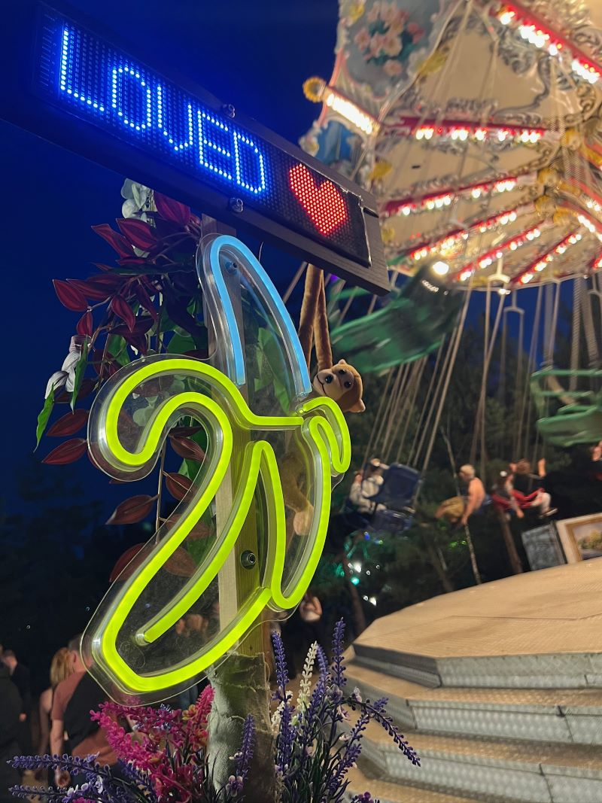

<h1 align="center">🍌 RavestickBoard</h1>

<strong>Offline-Webcontroller für die 64 × 16-Pixel-LED-Tafel CoolLEDX / CoolLED1248 mit ESP32-C3.</strong> 
Entstanden aus einer Festival-Banane und dem Wunsch, mehr aus der ursprünglichen CoolLED1248-App herauszuholen.

> **Aktueller Entwicklungskandidat: v0.6.1.6-dev (12.11.2026).** *Neu gegenüber 0.6.1.5:* Antwort auf den Hardwaretest von 0.6.1.5 (1:44 h, 96 Aufträge, zwei Geräte, **kein Neustart**; der Abruf großer Animationen senkt das System-Minimum nicht mehr). Offen war nur ein Befund: Während einer Übertragung zur Tafel beantwortete der ESP32 keine Webanfrage. Jetzt **antwortet er auch während einer Übertragung** – kurz und nur mit dem Status, einer kleinen Warteseite oder „Übertragung läuft“ (409) – und **alle Geräte sperren in dieser Zeit die Knöpfe, die senden oder etwas ändern**; auf dem Bedienfeld liegt dann „Übertragung läuft …“. Ein Schalter `RB_WEB_DURING_BLE` stellt das alte Verhalten wieder her. Dazu: **Seiten mit Liste sind genau fensterhoch** (Bedienfeld unten bündig und so breit wie die Flächen, Listen scrollen innen), passend für kleine Displays wie das iPhone SE; **Blocktext mit 40 Seiten** (Test, vorher 25); lange Namen blenden weich aus und laufen beim Auswählen einmal durch; Umlaute in allen Meldungen; die Vorschau im Editor lädt ihre Schrift wieder nach (Ursache für „Vorschau aus“ auf dem SE); **neun Beispiel-Animationen** unter `assets/animationen/`. *Neu in 0.6.1.5 gegenüber 0.6.1.4:* Antwort auf den Hardwaretest von 0.6.1.4, in dem das System-Minimum beim Abruf großer Animationen wieder auf 400 Byte fiel und der Wächter das Board neu startete. Der Abruf holt jetzt **1200 Byte je Anfrage in einer Antwort mit bekannter Länge** und prüft **freien Heap und größten Block**; lesende Listen-Anfragen werden bei knappem Heap mit **503** vertagt (der Browser wiederholt), und die Startseite liefert dann eine **kleine Warteseite** statt eines weißen Bildschirms. Nach einer Animation setzt die Firmware den **Anzeigemodus hinter den Daten noch einmal** (Ambiente und Blockseiten liefen sonst mit Linkslauf). Eine Ablehnung durch die Tafel erscheint als Meldung. Neu in der Oberfläche: **Rückwärts abspielen**, **Animationen sortieren**, **Mehrfachauswahl zum Löschen** (Laptop), **Seitenleiste am Laptop**, Menü unter der Banane. Das WLAN heißt jetzt **`RavestickBoard`** (Passwort unverändert). *Neu in 0.6.1.4 gegenüber 0.6.1.3:* Antwort auf den Hardwaretest von 0.6.1.3. Der **Abruf einer gespeicherten Animation geschieht in Teilen** (je höchstens 3000 Byte) und wird mit **503 „Speicher knapp“** abgewiesen, wenn der freie Heap unter 16.000 Byte liegt (der Browser wartet dann kurz und fragt erneut); die große Einzelantwort hatte den Heap bis auf wenige hundert Byte geleert und einen Wächter-Neustart ausgelöst. **Neue Animationen bekommen die kleinste freie Nummer** (ohne Datei und ohne Kurzwahl, die darauf zeigt), und **das Löschen einer Animation fasst die Kurzwahlen nicht mehr an** (die Kachel zeigt „Animation fehlt“; das ersetzt die Regel von 0.6.1.3). **Die Tasten zum Erzwingen des Anzeigeverhaltens sind gesperrt, solange eine Animation läuft** (nur Anzeige an/aus bleibt), wie der Tempo-Regler. Die Hinweistexte in der Bearbeitungsansicht entfallen. Der BLE-Hänger (`ble_connect`, `ble_regNotify`) ist weiter offen. *Neu in 0.6.1.3 gegenüber 0.6.1.2:* Aufräum-Build nach dem Code-Review vom 4.11.2026, **keine neue Bedienfunktion**: Animationsdateien bekommen eine Prüfsumme (CRC-32), ein Lesefehler beim Senden bricht den Auftrag ab, das Löschen einer Animation leert die zugehörigen Kurzwahlen, das Ersetzen beim Bearbeiten ist abgesichert, die ungenutzte Route `/api/anim/duplicate` ist entfernt, die Diagnose zeigt den kleinsten freien Stapel, alte Tests liegen in `tests/legacy/`, alte Dokumente in `docs/archive/`. 0.6.1.2 ist auf der Hardware kompiliert und getestet und läuft; die Bildqualität importierter GIFs ist wegen der Grenzen der Tafel (64 × 16 Pixel, sieben Farben) mittelmäßig. *Die folgenden Sätze dieses Absatzes beschreiben den jeweiligen Bauzeitpunkt.* *Neu in 0.6.1.2 gegenüber 0.6.1.1:* Ausschnitt-Rahmen statt Schieberegler, „Nur senden“, Animationen als Kurzwahl, Icon `image-play` (Details unten). Außerdem neu: Bearbeiten gespeicherter Animationen (Zeit, Bildbereich, Reihenfolge, Name; Speichern überschreibt unter derselben Nummer). 0.6.1.1 hatte den Arduino-Compile-Fehler von 0.6.1.0 behoben (`rb42ProgramPlaying` in `RavestickBoard_Anim.h`). *Animationen als eigener Bereich:* Im Menü gibt es jetzt **Animationen**. Dort werden GIFs, Bildstreifen oder ein Text-Raster (Buchstaben `.RGBCMYW`, zum Beispiel aus Excel) im Browser auf 64 × 16 Pixel und die sieben LED-Farben gebracht, als Datei im ESP32 gespeichert und per Knopf als gespeicherte Animation (Befehl `0x04`) an die Tafel gesendet. Der Hardwaretest von 0.6.0.2 hat gezeigt: Die Tafel nimmt `0x04` an, Farben, Nummern und Laufrichtung stimmen, 1/2/3/8 ms laufen flüssig, die Animation bleibt nach dem Ausschalten der Tafel erhalten und ein späterer Text ersetzt sie sauber. **Neu gebaut und nicht geprüft** sind: der Arduino-Compile (neue Datei `RavestickBoard_Anim.h`), alle Dateifunktionen auf dem echten ESP32 (LittleFS, Webserver), das Senden einer gespeicherten Animation über BLE (79 Bilder dauern rund 55 s), und die Weboberfläche auf iPhone und iPad. Der Tempo-Regler ist, solange eine Animation auf der Tafel liegt, gesperrt (er wirkt dort nicht). Der Animationsversand **ersetzt den Inhalt der Tafel**. Darunter unverändert 0.5.0.1 (Tafelverwaltung) und der Animationstest in den Einstellungen. Vollständige Versionsgeschichte: [`CHANGELOG.md`](CHANGELOG.md), Kurzüberblick: [`VERSIONSGESCHICHTE.md`](VERSIONSGESCHICHTE.md), Testschritte: [`docs/TESTPLAN_v0.6.1.6.md`](docs/TESTPLAN_v0.6.1.6.md).

## Was ist RavestickBoard?

Das iPhone oder ein anderer Browser verbindet sich mit dem WLAN `RavestickBoard` des **ESP32-C3 Super Mini** (bis 0.6.1.4 hieß es `CoolLED1248`). Das lokale Webinterface unter **http://192.168.4.1** überträgt die Darstellung via Bluetooth Low Energy (FFF0/FFF1) an die **CoolLEDX-Tafel**. Die LED-Tafel benötigt keine modifizierte Herstellerfirmware und kann einmal hochgeladene Inhalte autonom wiederholen. Die Bedienoberfläche läuft ohne Internetzugang; USB bleibt der einzige Firmware-Updateweg, **kein OTA**.

**Was die Oberfläche kann:**

- **Kurzwahl:** acht frei belegbare Kacheln (Bibliothekseinträge, Programme, Ambiente) für den schnellen Zugriff auf der Veranstaltung.
- **Lauftext:** Original-Schriften (Normal, Fett), Engschrift und Mini (ein- oder zweizeilig), 24 Herstellersymbole plus eigene Motive, Live-Vorschau und Datenbudget. Farbe und Schrift lassen sich pro Zeichen gestalten.
- **Animationen (Menü, seit 0.6.1.0):** eigener Bereich, getrennt von Lauftext, Seiten und Programmen. Import von GIF, Einzelbildern aus einem Bild (früher „Bildstreifen“) und Text-Raster (`.RGBCMYW`; neun fertige Beispiele in [`assets/animationen/`](assets/animationen/LIESMICH.md)), Anpassen (Ausschnitt-Rahmen 4 : 1 auf dem Quellbild, Farbreduktion auf sieben LED-Farben, Bildauswahl, Zeit je Bild), Vorschau, Speichern im ESP32 (bis zu 40 Animationen, je höchstens 79 Bilder), Senden an die Tafel (auch „Nur senden“ ohne Speichern), als Kurzwahl belegbar, Bearbeiten (Zeit, Bilder, Name), Umbenennen, Löschen. Die Tafel speichert und spielt die Animation selbst.
  - *So verhält sich eine Animation auf der Tafel* (bis 0.6.1.5 stand das als Hinweis in der Oberfläche): Eine gesendete Animation ersetzt den Inhalt der Tafel. Die Tafel speichert sie und spielt sie selbst in Dauerschleife ab, auch nach dem Ausschalten, bis du wieder etwas sendest. Tempo-Regler und Anzeigemodus wirken bei Animationen nicht; die Geschwindigkeit steckt in der Animation (Zeit je Frame). Höchstens 79 Frames; das Senden dauert je nach Länge bis etwa eine Minute (79 Frames: 52 s).
  - *Während einer Übertragung* (seit 0.6.1.6) sind auf allen verbundenen Geräten die Knöpfe gesperrt, die senden oder etwas ändern; auf dem Bedienfeld steht „Übertragung läuft …“. Seiten wechseln und bereits geladene Listen ansehen geht weiter. Eine Seite, die vorher noch nicht geladen war, zeigt erst nach der Übertragung ihren Inhalt; Vorschauen von Animationen laden in dieser Zeit nicht. Ein Gerät, das die Oberfläche gerade neu öffnet, bekommt eine kleine Warteseite, die sich selbst neu lädt. Es gibt bewusst keinen zusätzlichen Hinweis, *warum* die Knöpfe gesperrt sind – das steht hier.
- **Animationstest (Einstellungen, seit 0.6.0.0):** sendet eingebaute Testmuster (Frame-Nummern, Vollbildfarben, Balken) als gespeicherte Animation (Befehl `0x04`) und zeigt die Antwortcodes der Tafel in der Diagnose. Bleibt als Prüfwerkzeug erhalten; die Muster sind auch Vorlage für spätere Zähler- oder Uhrzeit-Anzeigen (Zukunftsmusik, siehe Themenspeicher).
- **Tafelverwaltung (Einstellungen):** Tafeln suchen (Trefferliste mit Signalstärke), „Meine Tafel“ im ESP32 speichern, eine fremde Tafel vorübergehend nutzen und per Knopf zurückwechseln. Die Einstellungen zeigen, ob „Meine Tafel“, eine fremde Tafel oder keine Tafel aktiv ist.
- **Blocktext** (bis 0.6.1.5 „Blockanzeige“/„Blockfolge“): bis zu 40 feste Seiten (seit 0.6.1.6; vorher 25) mit Ausrichtung und Anzeigedauer, als Ganzes sendbar. Farbe und Schrift lassen sich auch hier pro Zeichen gestalten; „Mini einzeilig“ lässt sich links, mittig oder rechts ausrichten.
- **Bibliothek und Programme:** Einträge speichern, benennen, duplizieren, sortieren; Programme spielen Einträge nacheinander ab (Original oder als gemeinsames Laufband). Am Laptop lassen sich mehrere Einträge markieren und gemeinsam löschen (seit 0.6.1.5).
- **Tafelsteuerung:** Helligkeit, Tempo und Anzeige an/aus stehen unten auf jeder Seite; die Tasten zum Erzwingen eines Anzeigeverhaltens auf allen Seiten außer der Kurzwahl, wo nur Linkslauf, Standbild und der Stift zum Bearbeiten bleiben.
- **Diagnose:** RAM-Messung, HTTP-Spur, Absturzspur nach Hänger, Export als Textdatei.

## Aktuell: v0.6.1.6-dev – Antworten während der Übertragung, Rahmen, 40 Blocktext-Seiten, Beispiel-Animationen (aufbauend auf 0.6.1.5)

- **Neu in 0.6.1.6** (Antwort auf den Hardwaretest von 0.6.1.5 und die gesammelten Punkte vom 12.11.2026; Go am 12.11.2026):
  - **Antworten während einer Übertragung (Befund B5/F9):** Bisher bediente der ESP32 Webanfragen nur zwischen zwei Aufträgen; eine große Animation (52 s) machte ihn für alle Geräte taub (weißer Bildschirm auf dem zweiten Gerät, ein Löschen wurde erst danach ausgeführt). Jetzt ruft der laufende Auftrag in seinen Wartepausen höchstens alle 250 ms `web.handleClient()` auf. Solange ein Auftrag läuft, beantworten **alle** Routen nur noch: `/api/status` mit einem kleinen Status (`"busy":true`), `/` mit einer kleinen Warteseite (503, lädt nach 3 s neu), alles andere sofort mit **409 „Übertragung läuft.“**. Kein normaler Handler läuft innerhalb des Auftrags. Schalter `RB_WEB_DURING_BLE` (Standard 1; 0 = Verhalten von 0.6.1.5).
  - **Sperre auf allen Geräten:** Meldet der Status „busy“, sperrt die Oberfläche alle Knöpfe, die senden oder etwas ändern (auch Regler und Kurzwahl-Kacheln), und legt „Übertragung läuft …“ mit pulsierendem Punkt **auf** das Bedienfeld (es wird nicht größer). Schreibende Anfragen gehen in dieser Zeit gar nicht erst hinaus; lesende, die mit 409 abgewiesen werden, wiederholt der Browser alle 1,5 s. Während der Übertragung fragt jedes Gerät den Status nur noch etwa alle 2,4 s. Notbremse: Meldet der Status zwei Minuten lang nichts, löst sich die Sperre von selbst.
  - **Diagnose:** neue Zeilen „Webantworten in Übertragungen …“ (Aufrufe, Status, Warteseite, 409, längster Aufruf) und **„Stapel vor der ersten Webantwort … / danach“** – das ist der wichtigste Messwert des Hardwaretests.
  - **Rahmen:** Kurzwahl, Bibliothek, Programme, Animationen und Ambiente sind genau fensterhoch. Das Bedienfeld sitzt unten bündig (oben rund, unten ohne Linie und Abstand) und ist so breit wie die Flächen darüber; Listen scrollen innen. Texteditor und die Bearbeitungsansichten scrollen wie bisher. Ein Flächenton `#1d222e` für Karten, Kacheln, Bedienfeld und Menü. Gilt für Handy und Laptop.
  - **Kleine Displays (iPhone SE 375 × 667):** Die sieben Ambiente-Farben teilen sich die Höhe (Weiß bleibt sichtbar, mindestens 34 Pixel, sonst scrollen sie innen); unter 400 Pixel Breite stehen die Bedienfeld-Tasten 30 Pixel groß in einer Reihe; unter 700 Pixel Höhe ist die Kopfzeile kompakter. Der lange Hinweistext unter der Animationsliste entfällt (steht jetzt oben unter „Was die Oberfläche kann“).
  - **Lange Namen:** blenden in Listen weich aus (Verlauf statt „…“), laufen beim Auswählen einmal als Lauftext durch und zeigen am Laptop den vollen Namen als Tooltip. Beim Import entsteht der Name aus dem Dateinamen (Endung weg, `_`/`-` zu Leerzeichen, großer Anfangsbuchstabe; Kennungen wie `IMG_2041.gif` oder `giphy.gif` werden „Animation TT.MM.“).
  - **Umlaute** in allen Meldungen von Firmware und Oberfläche (z. B. „Datenlänge zu groß“ statt „Datenlaenge zu gross“).
  - **Blocktext:** Überschrift „Blocktext · Seite X von 40“, beide Hinweistexte entfernt, gleich große Seitenknöpfe, schmaler Scrollbalken, „Mini einzeilig“ mit links/mittig/rechts (Firmware und Vorschau), überall „Blocktext“ statt „Blockanzeige“/„Blockfolge“. **40 Seiten statt 25** (`PAGE_LIMIT`, `RB42_PAGES`; Test, herunterkorrigieren geht jederzeit). Das kostet fest etwa **3,1 KB RAM** (zwei Seitenfelder zu je 15 × 102 Byte mehr). Gespeicherte Blocktexte aus 0.6.1.5 (25 Plätze) werden weiter gelesen und beim nächsten Speichern im neuen Format abgelegt.
  - **Vorschau im Editor auf dem iPhone SE („aus“):** Ursache war nicht das ältere iOS 18, sondern die Schrift für die Vorschau: Sie wurde beim Start genau einmal geholt. Antwortete der ESP32 da mit 503 (wenig Speicher, typisch beim zweiten Gerät), blieb die Vorschau für immer dunkel; Senden ging trotzdem. Jetzt wird die Schrift im Hintergrund nachgeladen, bis sie da ist. In der Oberfläche steckt keine Browserfunktion, die erst Safari 26 kann.
  - **Animations-Vorschau:** Beim Wechsel hält die alte Vorschau sofort an; „Vorschau wird geladen …“ steht fett; das Vorschaufeld bleibt immer sichtbar (leer bei keiner, mehreren oder beschädigter Auswahl).
  - **Kurzwahl-Dialog:** beschädigte Programme stehen ausgegraut mit „(beschädigt)“ in der Auswahl und sind nicht wählbar; Meldungen erscheinen im Dialog statt dahinter.
  - **Import:** „GIF importieren“; „Bildstreifen“ heißt jetzt „Einzelbilder aus einem Bild“ mit einem Satz Erklärung.
  - **Kleinigkeiten:** Mülleimer in Bibliothek, Programmen und Animationen rot wie überall; „Als Kopie speichern“ (Animation) fragt nach dem Namen und schlägt „… (Kopie)“ vor.
  - **Beispiel-Animationen:** neun Text-Raster-Dateien (Herzschlag, Equalizer, Regenbogenwelle, Sternenhimmel, RAVE blinkt, Pfeile nach rechts und nach links, Lagerfeuer, Smileys) mit Vorschau-GIF und Anleitung in [`assets/animationen/LIESMICH.md`](assets/animationen/LIESMICH.md); erzeugt mit `tools/beispiel_animationen.py`.
  - **Hardwaretest von 0.6.1.5 (deine Rückmeldung vom 12.11.2026):** 44 Schritte in Ordnung, 1 nicht in Ordnung (B5), 9 nicht getestet, 9 „siehe Log“. 1:44 h, 96 Aufträge, zwei Geräte, **kein Neustart**; 79 Bilder in 52 s. `/api/anim/get` senkt das System-Minimum nicht mehr (0 Abfälle in `/api/*`, 0.6.1.4: 6); 503 nur viermal, unsichtbar wiederholt. Das System-Minimum von 2.632 Byte entstand 20–23 s nach dem Start beim Einbuchen des ersten Geräts, vor jeder Anfrage (Vermutung: WLAN-Pakete beim Verbinden). Während einer großen Übertragung mit zwei Geräten etwa 22 KB frei, größter Block 7–10 KB; kleinster freier Stapel 3.656 Byte. C1/C2 (Modus nach Animation) in Ordnung, D1 in Ordnung (Meldung kam, aber ohne Umlaute).
  - **Nicht in diesem Build (0.6.1.7):** Animations-Übersicht als Raster (Entwurf abgestimmt: zwei Spalten, festes erstes Bild, Senden und Stift je Kachel, „Liste“ oben), Markierung „auf der Tafel“ in allen Bereichen, Vorschau in der Bibliothek. Zeichen-Editor nur mit eigenem Go. Alles in Roadmap und Themenspeicher.
  - **Nicht geprüft:** Arduino-Compile; ob der Stapel für die Antworten innerhalb der Übertragung reicht (**Hauptfrage des Tests**, Diagnosezeile „Stapel …“); ob die Tafel die kurzen Pausen zwischen den Paketen verträgt und wie viel länger eine Übertragung dauert; Heap mit 40 Blocktext-Seiten; Safari auf dem echten iPhone SE.
  - **Rückweg:** Ein Blocktext, der mit 0.6.1.6 gespeichert wird, hat das neue Format (40 Plätze). Firmware 0.6.1.5 und älter liest ihn nicht mehr (er erscheint dort als beschädigt). Vor dem Flashen ein JSON-Backup ziehen; es enthält die Seiten unabhängig vom Dateiformat.

### Zuvor: v0.6.1.5-dev – Heap-Schutz, Modus nach Animation, Mehrfachauswahl, Laptop-Ansicht (aufbauend auf 0.6.1.4)

- **Neu in 0.6.1.5** (Antwort auf den Hardwaretest von 0.6.1.4 und deine Wünsche vom 12.11.2026; du wolltest „direkt mehr in den Build“ – die drei besprochenen Blöcke Stabilität, Bedienung und Laptop-Ansicht stecken deshalb in **einer** Version):
  - **Abruf in kleineren Teilen, als eine Antwort:** `GET /api/anim/get` liefert höchstens **1200 Byte** Nutzlast je Anfrage. Die Antwort entsteht vollständig in einem vorab reservierten Puffer und geht mit bekannter Länge in einem Schreibvorgang hinaus (vorher viele kleine Chunks). Die Datei ist vor dem Senden geschlossen. Neues Feld `heap` (freier Heap beim Start der Anfrage); danach richtet der Browser seine Pause zwischen den Teilen (110 ms, unter 28.000 Byte 380 ms).
  - **Strengere Prüfung:** 503 „Speicher knapp“, wenn der freie Heap unter **24.000 Byte** oder der größte freie Block unter **10.000 Byte** liegt oder der Antwortpuffer nicht zu bekommen ist. Der Browser wartet 450 ms und fragt erneut (bis 40-mal).
  - **Heap-Schutz für lesende Listen:** `/api/library`, `/api/library/get`, `/api/collections`, `/api/collections/get`, `/api/shortcuts`, `/api/anim/list`, `/api/program`, `/api/font`, `/api/sign` und `/api/block/get` antworten unter 20.000 Byte freiem Heap mit 503; die Oberfläche wiederholt lesende Anfragen unsichtbar (bis 8-mal, 450 ms), schreibende nie. Status, Diagnose und die Textexporte bleiben immer erreichbar.
  - **Warteseite statt weißem Bildschirm (D9):** Liegt der freie Heap beim Abruf der Startseite unter 22.000 Byte, kommt eine kleine Seite „Der Controller hat gerade wenig freien Speicher …“, die sich nach zwei Sekunden selbst neu lädt; „Trotzdem laden“ (`/?force=1`) umgeht die Prüfung. Ein Browser mit gültiger Kopie (ETag) bekommt wie bisher 304.
  - **Diagnose:** neue Zeile „HTTP-Anfragen wegen knappem Heap vertagt (503): …“.
  - **Anzeigemodus nach einer Animation (H2, J14):** Der erste Text-, Block- oder Ambiente-Auftrag nach einer Animation (oder nach dem Start) setzt den Modus hinter den Datenpaketen noch einmal (Ereignis „Anzeigemodus nach den Daten erneut gesetzt …“). Das ist ein Versuch; ob die Tafel ihn befolgt, zeigt erst der Hardwaretest.
  - **Meldung bei Fehlern der Tafel (D10):** Scheitert ein Sendeauftrag, den dieser Browser gestartet hat, zeigt die Oberfläche die Fehlermeldung (z. B. „Tafel lehnt Paket 1 von 241 ab …“).
  - **Tempo-Regler sichtbar gesperrt (A4, D5)**, **Ausschnitt-Rahmen scharf (F1)**: beim Vergrößern ohne Weichzeichnen.
  - **Rückwärts abspielen:** Kästchen im Import und beim Bearbeiten; wirkt vor „Hin und zurück“.
  - **Text-Raster leeren:** Das Eingabefeld ist beim nächsten Öffnen des Imports leer und zugeklappt.
  - **Animationen sortieren:** Pfeile wie in der Bibliothek; die Reihenfolge liegt im ESP32 (`/rb-anim/order.bin`, Route `POST /api/anim/move`). Neue Animationen kommen ans Ende, auch mit wiederverwendeter Nummer; Kurzwahlen und Nummern bleiben unberührt.
  - **Mehrfachauswahl zum Löschen (nur Maus und Tastatur):** In Bibliothek (Texte und Blockfolgen), Programmen und Animationen: Strg-/Cmd-Klick nimmt dazu oder weg, Umschalt-Klick wählt einen Bereich, Strg+A alle, Esc hebt auf, Entf löscht. Ab zwei markierten Einträgen ist nur „Löschen“ bedienbar. Eine Rückfrage mit Anzahl, Namen und Verwendung (Programme, Kurzwahlen); gelöscht wird nacheinander, ein „beschäftigt“ beendet den Durchlauf, am Ende steht eine Meldung. Auf Handy und Tablet bleibt es bei der Einzelauswahl.
  - **Laptop-Ansicht (ab 1000 Pixel Fensterbreite):** feste Seitenleiste mit Logo, Version und allen Seiten statt Bananen-Menü; Inhalt bis 860 Pixel breit, die Kurzwahl bis 1120 Pixel mit vier Kacheln pro Zeile. Darunter bleibt die Banane; das Menü öffnet jetzt unter ihr statt am Bildschirmrand. Bedienfeld und Menü haben die Flächenfarbe der Karten, das Bedienfeld ist so breit wie der Inhalt.
  - **Name:** WLAN `RavestickBoard` (Passwort unverändert), Titel in Oberfläche und Diagnose nur noch „RavestickBoard“ (ADR-2026-11-12-A). **Nach dem Flashen musst du dich mit dem neuen WLAN verbinden.**
  - **Hardwaretest von 0.6.1.4 (deine Rückmeldung):** Hardwaretest von 0.6.1.4 (Excel, Diagnose-, RAM- und HTTP-Exporte und Seriallog vom 12.11.2026): 70 Schritte in Ordnung, 13 nicht getestet, 9 ohne Eintrag. Compile: Sketch 1.599.925 Byte (76 %), globale Variablen 80.408 Byte (24 %), nur die vier bekannten `-Wvolatile`-Warnungen. **Hauptbefund:** Der Abruf in Teilen zu 3000 Byte löste den Heap-Engpass nicht. Jeder Teil senkte den freien Heap kurzzeitig um 13 bis 23 KB (Beispiel: 34.940 → 13.296 Byte), alle Stufen des System-Minimums (4.032 → 3.468 → 2.696 → 2.168 → 1.900 → 1.800 → 1.720 → 1.172 → 400 Byte) fielen in `/api/anim/get`-Anfragen, und direkt nach einem Animationsversand mit zwei Geräten startete der Wächter das Board in der Phase `anim_get` neu (frei 5.224 Byte, System-Minimum 400 Byte). Die Prüfung auf 16.000 Byte am Anfang einer Anfrage schützte nicht. Ruhe-Heap mit zwei Geräten etwa 31 KB (nach dem Start des WLAN 58 KB; BLE belegt beim Start rund 73 KB). Weitere Befunde: Ambiente aus der Kurzwahl und ein Block-Text liefen direkt nach einer Animation mit Linkslauf (H2, J14; ein zweiter Klick korrigierte es); die Ablehnung von 80 Bildern (Code 0x04, nach 1,4 s) erschien nicht in der Oberfläche (D10); der Tempo-Regler war gesperrt, sah aber unverändert aus (A4, D5); das Bild unter dem Ausschnitt-Rahmen wirkte weichgezeichnet (F1); das iPhone zeigte eine weiße Seite, solange der Laptop eine große Animation sendete (D9). 79 Bilder brauchten 52 s (wie 0.6.1.3), kleinster freier Stapel 3.788 Byte (0.6.1.3: 4.856).
  - **Nicht in diesem Build:** Vorschau in der Bibliothek am Laptop, Kontrast anheben (optional), NimBLE statt Bluedroid (Entscheidung offen), Zugriff ohne WLAN-Wechsel, Frames durch Verschieben (Zeichen-Editor). Alles im Themenspeicher.
  - **Nicht geprüft:** Arduino-Compile und -Link (neu genutzt: `ESP.getMaxAllocHeap()`, `String::reserve`, `web.send` mit `String`), ob die kleineren Teile und die 503-Schwellen auf dem echten ESP32 den Heap schonen (**Hauptfrage des nächsten Tests**), ob die Tafel den Modus hinter den Daten befolgt, Safari auf iPhone und iPad (die CSS-Regel für den gesperrten Regler braucht `:has()`, ab iOS 15.4), echtes LittleFS mit `order.bin`.

### Zuvor: v0.6.1.4-dev – Abruf in Teilen, freie Animations-Nummern (aufbauend auf 0.6.1.3: Prüfsumme, sicheres Ersetzen)

- **Neu in 0.6.1.4** (Antwort auf den Hardwaretest von 0.6.1.3; du hast „Okay, dann wie besprochen“ gesagt):
  - **Abruf in Teilen mit Heap-Schutz:** `GET /api/anim/get?id=&off=&len=` liefert höchstens 3000 Byte Nutzlast je Antwort (Felder `total`, `off`, `n`). Liegt der freie Heap beim Start der Anfrage unter 16.000 Byte, antwortet die Firmware mit **503 „Speicher knapp, bitte gleich noch einmal versuchen.“** Die Weboberfläche setzt die Teile zusammen, prüft die Längen und wartet bei 503 jeweils 300 ms (bis zu 30 Wiederholungen, dann Fehlermeldung). Auf dem Stapel liegen nur noch 600-Byte-Puffer.
  - **Kleinste freie Nummer statt Zähler (Befund J4 des Hardwaretests):** Eine neue Animation bekommt die kleinste Nummer von 1 bis 9999, zu der **weder eine Datei noch eine Kurzwahl vom Typ 4** gehört. Eine Nummer, die eine Kurzwahl noch belegt, wird also nicht wiederverwendet; ist die Kurzwahl-Datei beschädigt, gilt höchste Nummer + 1. Es gibt keinen dauerhaften Zähler und damit keine Obergrenze, die sich nicht zurücksetzen ließe. Sind alle 9999 Nummern vergeben, meldet der Upload 507.
  - **Löschen lässt Kurzwahlen unberührt:** Das ändert die Regel von 0.6.1.3 (siehe `docs/ENTSCHEIDUNGEN.md`, ADR-2026-11-04-J). Die Kachel zeigt danach „Animation fehlt“ und sendet nichts; man kann sie neu belegen oder leeren. Das Löschen scheitert nicht mehr an einer beschädigten Kurzwahl-Datei. Der Rückfragetext sagt das.
  - **Anzeige-Tasten bei laufender Animation gesperrt:** Die Tasten zum Erzwingen des Anzeigeverhaltens (Linkslauf, Standbild usw.) sind ausgegraut, solange der Status `animActive` meldet; Anzeige an/aus bleibt. Der Hinweistext der Tasten sagt warum. Danach sind sie wieder frei.
  - **Hinweistexte der Bearbeitungsansicht entfallen (Z2 aus dem Excel):** Die beiden Absätze „„Speichern“ überschreibt diese Animation …“ und „„Nur senden“ legt die Animation nur vorübergehend …“ sind entfernt (Wunsch „kann entfallen“).
  - **Vorgemerkt (Z1 aus dem Excel, ANM-24):** Ambiente künftig technisch als Animation mit gleichbleibenden Bildern übertragen, damit sich das Verhalten nicht erzwingen lässt. Nur die Idee, nichts gebaut.
  - **Hardwaretest von 0.6.1.3 (deine Rückmeldung):** Hardwaretest von 0.6.1.3 (Excel, vier Berichte und Seriallog vom 4.11.2026): 54 Schritte in Ordnung, 1 nicht in Ordnung, 5 nicht getestet, 18 offen. Die Tafel lehnt 80 Bilder schon beim ersten Paket mit Statuscode 0x04 („Datenlänge zu groß“) ab, 79 Bilder gehen durch (rund 53 s). **Wichtigster Befund:** Der Abruf einer gespeicherten Animation (`GET /api/anim/get`, wird beim Auswählen und Bearbeiten benutzt) liefert die ganze Nutzlast (bis etwa 40 KB Base64) in einer Antwort; dabei fiel der freie Heap von etwa 31 KB auf 1.640 Byte, das System-Minimum auf 352 Byte, eine Anfrage dauerte 5,5 s, und der Wächter startete das Board in der Phase `anim_get` neu. Zwei weitere Wächter-Neustarts liefen in `ble_regNotify` und `ble_connect` (BLE-Hänger, Ursache offen). Kleinster freier Stapel 4.856 Byte von 8 KB, globale Variablen 79.452 Byte (24 %), Sketch 1.583.589 Byte (75 %) im Compilerlog; die einzigen Compilerwarnungen sind vier `-Wvolatile`.
  - **Weitere Beobachtungen, nicht in diesem Build behandelt:** Seite `/` lädt beim ersten Aufruf bis zu 2,5 s (A2); die Liste `GET /api/anim/list` senkte in einem Export das System-Minimum während der Anfrage von 7.400 auf 3.920 Byte (sie streamt ebenfalls rund 24 KB bei 40 Animationen; Messung und mögliche Seitenaufteilung stehen als ANM-22 im Themenspeicher); „Als neue Animation speichern“ (J3) wartet auf deine Rückmeldung; „Werkseinstellungen/gezielt löschen“ (SYS-14) ist nur vorgemerkt.
  - **Nicht geprüft:** Arduino-Compile und -Link (die neue Heap-Abfrage nutzt `ESP.getFreeHeap()`, die Stücke nur vorhandene Funktionen), ob die Teile auf dem echten ESP32 den Heap spürbar schonen (**das ist die Hauptfrage des nächsten Tests**), Wiederholung bei 503 im echten Betrieb, zwei Geräte gleichzeitig (D9), echtes LittleFS, BLE.

### Zuvor: v0.6.1.3-dev – Aufräum-Build nach dem Code-Review (aufbauend auf 0.6.1.2: Animationen, Ausschnitt-Rahmen, Kurzwahl)

- **Neu in 0.6.1.3** (Ergebnis des Code-Reviews vom 4.11.2026; du hast „Dann los“ gesagt):
  - **Prüfsumme für Animationen (Befund M1):** Der Browser berechnet die CRC-32 der Nutzlast und schickt sie mit dem ersten Stück. Der ESP32 liest die fertig geschriebene Datei noch einmal und vergleicht; bei Abweichung wird der Upload verworfen (Meldung „Prüfsumme stimmt nicht …“, HTTP 422). Vor jedem Senden prüft er die Datei erneut, bevor Bluetooth beteiligt ist. Die Prüfsumme steht im Dateikopf (4 Byte, Flag Bit 0); **ältere Dateien ohne Prüfsumme (aus 0.6.1.0 bis 0.6.1.2) bleiben gültig** und werden ohne diese Prüfung gesendet.
  - **Lesefehler beim Senden (M1):** Schlägt das Lesen aus der Datei fehl, bricht der Auftrag ab („Animation: Lesefehler …“), statt Nullbytes an die Tafel zu schicken.
  - **Kurzwahlen beim Löschen (M2) – *in 0.6.1.4 wieder abgelöst, siehe oben*:** Das Löschen einer Animation leerte in 0.6.1.3 Kurzwahlen vom Typ 4 mit dieser ID. Damit kann eine neue Animation, die dieselbe Nummer bekommt, nicht versehentlich über eine alte Kachel laufen. Lässt sich die Kurzwahl-Datei nicht sicher schreiben, wird **nichts** gelöscht. Die Rückfrage nennt die betroffenen Kurzwahlen weiter. (Gewählt statt eines dauerhaften ID-Zählers; siehe `docs/ENTSCHEIDUNGEN.md`.) „Animation fehlt“ erschien damit nur noch bei einer beschädigten Datei (seit 0.6.1.4 wieder auch nach dem Löschen).
  - **Sicheres Ersetzen (M3):** Beim Bearbeiten wird die alte Datei nie vor dem Erfolg gelöscht; im Notfall liegt sie kurz als `a<ID>.rba.bak` da und wird beim Start wiederhergestellt.
  - **Aufräumen (N1, N5, N6, N10):** eine liegengebliebene `up.tmp` wird vor der Speicherprüfung entfernt; der Browser prüft beim Laden die Länge der Nutzlast; die Route `/api/anim/duplicate` ist entfernt; Kopfkommentare der `.h`-Dateien aktualisiert; das Diagnoseprotokoll nennt gesendete Animationen „Animation startet“ (der Animationstest bleibt „Animationstest startet“).
  - **Messung (M4, M5):** Die Diagnose zeigt jetzt den **kleinsten freien Stapel** des Loop-Tasks (Text „Kleinster freier Stapel (Loop-Task)“, JSON `minStack`, `ram.txt`: „Stapel min“). Den Wert bitte nach einem Durchgang aller Animationsaktionen notieren; zusätzlich beim Arduino-Compile die Zeile „Globale Variablen verwenden … Bytes“ festhalten. Es gibt in diesem Build bewusst **keinen Speicherumbau**.
  - **Repository (N12, N13):** Tests älterer Versionen (nicht mehr lauffähig) liegen in `tests/legacy/`, alte Installations-, Test- und Entwicklungsstandsdokumente in `docs/archive/`. Das README verweist nur noch auf Vorhandenes.
  - **Nicht gemacht (Absprache siehe `docs/ENTSCHEIDUNGEN.md`):** N2 (die MTU-Vorprüfung vor dem Senden ist ein Schutz und bleibt), N3 (Helligkeit bei Animationen: wird im Hardwaretest beobachtet), N4, N7, N8, N9 (niedrig, vorgemerkt), N11 (der Zeichen-Editor wird ein eigenes Modul), N14 (WLAN-Passwort ändern bleibt SYS-13), V1 (`RB_TEST_HANG` bleibt in Entwicklungsbuilds auf 1; Punkt der Release-Checkliste).
  - **Nicht geprüft:** Arduino-Compile und -Link, echtes LittleFS (insbesondere `rename` auf ein vorhandenes Ziel), Senden aus der Datei über BLE, die neuen Abbruchwege im Sendeauftrag auf der Hardware (nur Quellinvarianten), Stapelreserve auf dem Gerät.
  - **Hardwaretest von 0.6.1.2 (deine Rückmeldung):** läuft; Bildqualität der GIFs mittelmäßig, bedingt durch die Tafel.
  - **Gesammelt, noch nicht gebaut:** Zeichen-Editor (0.6.2.0 Kern, 0.6.3.0 Komfort), Einzelheiten in `docs/ROADMAP.md` und `docs/THEMENSPEICHER.md` (ANM-06, ANM-19 bis ANM-21).

### Zuvor: v0.6.1.2-dev – Animationen: Import, Ausschnitt-Rahmen, Kurzwahl

- **Neu in 0.6.1.2** (deine Wünsche vom 3.11.2026):
  - **Ausschnitt-Rahmen:** Beim Import zeigt die Oberfläche das gewählte Bild (bei GIFs das Bild, das im Feld „Vorschau“/„von“ steht) mit einem gelben Rahmen im festen Seitenverhältnis 4 : 1; der Rahmeninhalt ist das, was durch Skalierung und Farbreduktion auf die Tafel kommt. Verschieben mit Finger, Stift oder Maus; Größe an den Ecken, mit zwei Fingern, mit dem Mausrad oder mit den Knöpfen „Rahmen kleiner/größer“. Außerhalb des Bildes ist die Tafel schwarz. Die vier Voreinstellungen (Einpassen, Füllen, Strecken, Original) setzen nur noch den Rahmen und sind danach frei veränderbar („Eigener Ausschnitt“). Die beiden Schieberegler für den Versatz sind entfallen.
  - **Bestehende Animation bearbeiten:** In der Liste gibt es den Knopf „Bearbeiten“ (Stift). Er öffnet die gespeicherte Animation in der Importansicht ohne Quelle und Ausschnitt (das Original-GIF ist nicht mehr da; gespeichert ist das fertige 64 × 16-Bild in sieben Farben). Änderbar sind **Zeit je Bild** (Bildrate), **Bildbereich** (von/bis), **jedes n-te Bild**, **Hin und Zurück** und der **Name**; die Vorschau läuft wie im Import. „Speichern“ **überschreibt** die Animation unter derselben Nummer, damit Kurzwahlen gültig bleiben (neuer Parameter `replace` beim Hochladen); „Als Kopie speichern“ legt eine neue Animation an, „Speichern und senden“ überschreibt und sendet, „Nur senden“ sendet ohne zu speichern. Bei vollem Speicher (24 KiB Reserve) schlägt das Überschreiben genauso fehl wie ein neues Speichern, weil die alte Datei erst nach dem Hochladen ersetzt wird. Einzelne Bilder löschen, verschieben oder malen kommt mit dem Zeichen-Editor (0.6.2.0).
  - **Drei Wege zur Tafel:** „Speichern“, „Speichern und senden“ (beides gab es schon) und neu **„Nur senden (nicht speichern)“**: Die Animation wird als temporäre Datei (`send.rba`) im ESP32 abgelegt, gesendet und danach gelöscht; es entsteht kein Listeneintrag. Das Limit von 40 Animationen sperrt nur das Speichern.
  - **Animationen als Kurzwahl:** Im Kurzwahl-Dialog ist die Quelle „Animationen“ freigeschaltet. Die Kachel sendet die gespeicherte Animation (Auftrag wie „Senden“ in der Liste). Die Kurzwahl merkt sich die **ID** der Animation. Wird die Animation gelöscht, zeigt die Kachel „Animation fehlt“ und sendet nichts (die Löschen-Rückfrage nennt vorher die betroffenen Kurzwahlen). Animationen sind weiterhin **nicht** im JSON-Backup der Bibliothek.
  - **Symbol:** Das Menü und die Quellenwahl der Kurzwahl nutzen das Lucide-Symbol `image-play` (ISC-Lizenz, siehe `THIRD_PARTY_NOTICES.md`) statt `film`.
  - **Senden-Knöpfe mint** wie in der Bibliothek (Liste, „Speichern und senden“, „Nur senden“).
  - **Duplizieren** gibt es in der Animationsliste nicht mehr (Wunsch vom 3.11.2026). Die Firmware-Route `/api/anim/duplicate` ist seit 0.6.1.3 entfernt.
  - **Nicht geprüft:** Arduino-Compile (neu: Änderungen in `RavestickBoard_Anim.h` und `RavestickBoard_v042.h`, Typ 4 in Kurzwahl-Speichern und -Ausführen), echtes LittleFS und BLE (Senden aus `send.rba`), Bedienung des Rahmens auf iPhone/iPad (Finger, Zwei-Finger-Geste, Apple Pencil, Scrollen der Seite), Kurzwahl-Typ 4 auf dem ESP (nur Hilfsfunktionen am Rechner geprüft, nicht der Sketch-Handler).
- **In 0.6.1.1** (Rückmeldung aus dem ersten Compile von 0.6.1.0): Der Sketch ließ sich nicht übersetzen, einziger Fehler: `'rb42ProgramPlaying' was not declared in this scope` in `RavestickBoard_Anim.h` (Zeile 411, in `onAnimSend`). Ursache: Ich hatte `RavestickBoard_Anim.h` direkt hinter `RavestickBoard_Library.h` eingebunden, die Variable `rb42ProgramPlaying` steht aber in `RavestickBoard_v042.h`, das erst weiter unten eingebunden wird. Die Einbindung steht jetzt hinter `RavestickBoard_v042.h`. Außerdem ist die unbenutzte Funktion `rb61CountAnims()` entfernt (Compiler-Warnung). **Sonst ist der Stand gleich 0.6.1.0.** Neu im Test: `tests/decl_order.py` setzt den Sketch mit seinen `.h`-Dateien in Include-Reihenfolge zusammen und meldet jeden Namen, der vor seiner ersten Deklaration benutzt wird; er findet den Fehler der Fassung 0.6.1.0 und nichts in 0.6.1.1. Das ersetzt keinen Compile (Näherung ohne Präprozessor), ist aber die zweite Prüfung dieser Art nach `arduino_prototypes.py`: Meine Rechnertests übersetzen nur Ausschnitte des Sketchs und konnten diesen Fehler nicht sehen. Weitere Compile-Fehler sind nicht ausgeschlossen; das Log von 0.6.1.0 enthielt außer diesem Fehler keinen weiteren, der Linker lief aber noch nicht.
- **Hardwaretest von 0.6.0.2 (deine Rückmeldung):** Farbreihenfolge (blau, grün, cyan, rot, magenta, gelb, weiß), lesbare Nummern und Balkenrichtung stimmen. Die Auswahl „Anzeigemodus danach“ (`0x06`) bewirkt nach dem Upload **nichts**. 1, 2, 3 und 8 ms je Bild laufen flüssig. Die Animation **bleibt nach dem Aus- und Einschalten der Tafel**. Ein späterer Text ersetzt sie sauber. Der **Tempo-Regler wirkt nicht auf Animationen**. Offen aus diesem Test: Wirkung des Helligkeitsreglers auf Animationen; die Grenzfälle 79 und 80 Bilder müssen wiederholt werden (der Versuch mit 80 Bildern kam wegen eines BLE-Verbindungshängers mit Wächter-Neustart nicht bis zur Tafel).
- **Neu in 0.6.1.0:**
  - **Menüpunkt „Animationen“** (seit 0.6.1.2 Lucide-Symbol `image-play`, vorher `film`). Die Liste zeigt je Animation eine Miniatur (erstes Bild), Name, Bildzahl und Zeit je Bild; beim Auswählen lädt die Oberfläche die Animation vom ESP32 und spielt sie in der Vorschau ab. Aktionen: Senden, Umbenennen, Duplizieren, Löschen. Beschädigte Dateien erscheinen als solche in der Liste (und zählen mit), damit sie sich löschen lassen.
  - **Import (alles im Browser):** *GIF* (eigener Decoder: Interlace, Teilbilder, Transparenz, Entsorgungsarten, Zeitangaben; am Rechner gegen den GIF-Decoder von Chromium geprüft, bis zu 300 Quellbilder), *Bildstreifen* (ein Bild mit mehreren Bildern nebeneinander oder untereinander) und *Text-Raster* (ein Buchstabe aus `.RGBCMYW` je Pixel; Zellen aus Excel (Tabulator-getrennt) oder direkt aneinandergeschrieben; leere Zeile oder `---` trennt die Bilder; 64 × 16 Zeichen entsprechen 1:1 der Tafel, andere Größen werden eingepasst).
  - **Anpassen:** Einpassen (komplett sichtbar, ausfüllen, strecken, Originalgröße) mit Verschieben, Farbreduktion auf die sieben LED-Farben (Schwelle, Floyd-Steinberg, Bayer; Schwellwert und Kontrast), Bildbereich, Schrittweite, Hin- und Zurück, Zeit je Bild (1 bis 2000 ms), wiederholte Bilder zum Halten. Mehr als 79 Bilder werden gemeldet; „Auf 79 Bilder verteilen“ wählt gleichmäßig aus.
  - **Speichern im ESP32:** Dateien `/rb-anim/a<ID>.rba` im Dateisystem der Bibliothek (LittleFS), 448 Byte Kopf (mit Vorschaubild) plus die Nutzlast, genau wie sie an die Tafel geht. Das Hochladen geschieht in Stücken zu 1200 Byte (Base64) in eine Zwischendatei, die am Ende umbenannt wird. Höchstens 40 Animationen; es bleibt eine Reserve von 24 KiB frei. Das **Dateisystem muss eingerichtet sein** (Bibliothek). Das Bibliotheksformat ist unverändert.
  - **Senden aus der Datei:** Die Firmware liest die Nutzlast beim Senden stückweise aus der Datei (kein Gesamtpuffer). Das Senden läuft als Auftrag wie der Animationstest: kein Tempo- und kein Modusbefehl vorab oder danach, strikte Auswertung der Antwortcodes. Dauer bei 79 Bildern etwa 55 s (Adam: 0,2 s je Paket); die Importansicht zeigt eine Schätzung der Übertragungsdauer.
  - **Tempo-Regler gesperrt, solange eine Animation läuft:** `/api/status` meldet `animActive`; nach dem Senden einer Animation ist der Regler gesperrt, nach Text, Seite, Band oder Ambiente wieder frei. Nach einem Neustart des ESP32 ist der Zustand unbekannt, der Regler bleibt dann bedienbar.
  - **Entfallen:** die Auswahl „Anzeigemodus danach“ im Animationstest (ohne Wirkung); die Firmware sendet nach Animationen keinen `0x06`.
  - **Die Testmuster bleiben:** Der Animationstest bleibt in den Einstellungen; die einzelnen Bilder (Nummern, Vollbildfarbe mit Nummer, Balken) sollen später für Zähler oder Uhrzeit nutzbar bleiben.
  - **Nicht enthalten:** Zeichen-Editor (0.6.2.0), Komfortfunktionen (0.6.3.0), Animationen als Kurzwahl (0.6.1.2), Animationen in Programmen.
  - **Entwicklungsschalter:** `RB_TEST_HANG` bleibt in diesem Stand auf 1.
  - **Geprüft (ohne Arduino/Hardware):** Dateispeicher mit dem echten Sketch-Code gegen ein Dateisystem im Speicher (Upload in Stücken, Liste, Abruf, Senden aus Datei, Umbenennen, Duplizieren, Löschen, Grenzen: 40 Animationen, 79 Bilder, Speicher voll, Schreibfehler, beschädigte Dateien); Nutzlast gegen die unabhängige Referenz, die schon die Firmware von 0.6.0.2 bestätigt hat (auf der Tafel richtig); GIF-Decoder, Raster- und Streifenimport, Farbumsetzung und Planung in Node; Weboberfläche in Chromium mit simulierter API (auch bei 390 px Breite ohne Zoom). **Nicht geprüft:** Arduino-Compile (insbesondere die Dateifunktionen des Cores 3.3.12), echtes LittleFS und Webserver mit 1,6-KB-Anfragen und ~40-KB-Abruf, das echte Senden über BLE aus der Datei, Speicher (Heap) mit zwei Geräten während des Sendens, iPhone/iPad-Safari (Dekodiergeschwindigkeit großer GIFs), Wirkung der Helligkeit auf Animationen.

- **Frühere Stände (unverändert, zur Einordnung):**
  - Animationstest mit Frame-Nummer (0.6.0.0 bis 0.6.0.2, aufbauend auf 0.5.0.1: Tafelverwaltung).

- **Neu in 0.6.0.2** (Rückmeldung aus dem ersten Compile von 0.6.0.1): Der Sketch ließ sich nicht übersetzen (`'RamStage' was not declared in this scope` bei `ramStageLabel` und `ramTraceMark`, Folgefehler an allen Aufrufstellen). Ursache: Ich hatte die Animationsfunktionen **vor** `enum RamStage` in die Datei gesetzt. Die Arduino-IDE erzeugt die Funktionsprototypen automatisch und setzt sie vor die erste Funktionsdefinition; dort kannte der Prototyp von `ramStageLabel(RamStage)` den Typ noch nicht. Die Funktionen stehen jetzt hinter den Typdefinitionen und hinter `rbPhase()`, Konstanten und Variablen der Animation bleiben oben. **Sonst ist der Stand gleich 0.6.0.1.** Neu im Test: `tests/arduino_prototypes.py` bildet diese Regel nach (kein selbstdefinierter Typ in einer Funktionssignatur vor der ersten Funktion); der Test erkennt die Fassung 0.6.0.1 als fehlerhaft und die kompilierte 0.5.0.1 als in Ordnung. Das ersetzt keinen Compile: weitere Fehler dieser Art sind nicht ausgeschlossen.

- **Neu in 0.6.0.1** (Vorschlag aus der Planung des Hardwaretests; 0.6.0.0 wurde nicht geflasht, 0.6.0.1 ließ sich nicht kompilieren):
  - **Frame-Nummer:** Jedes Frame der Testmuster zeigt seine Nummer, zweistellig und 1-basiert (01, 02 …), mit eigenen 3×5-Ziffern in doppelter Größe in der Mitte (14 × 10 Pixel). So sieht man bei 79 Frames, wie viele ankommen, wo die Schleife endet und ob die Reihenfolge stimmt. Farben: schwarz auf der Farbfläche, grün über dem Balken, weiß im Grenztest.
  - **Grenztest:** Standardzeit jetzt 300 ms (zuvor 40 ms), damit die Nummer lesbar ist; ein Durchlauf mit 79 Frames dauert etwa 24 s. Die Balkenfarbe wechselt alle 8 Frames durch sechs Farben ohne Weiß (Weiß ist der Nummer vorbehalten). Zum Lesen der Nummer sind etwa 300 ms oder mehr nötig; mit kürzeren Zeiten bleibt die Prüfung der Geschwindigkeit möglich.
  - **Sonst unverändert gegenüber 0.6.0.0**, siehe unten.
- **Neu in 0.6.0.0:**
  - **Animationstest (Einstellungen, ganz unten):** Vier Tasten senden ein eingebautes Muster als **gespeicherte Animation** an die Tafel: *Farben* (7 Frames, je eine der sieben LED-Farben, 700 ms), *Balken* (16 Frames, wandert von links nach rechts, 60 ms; oben links ein roter, unten rechts ein blauer Eckpixel zur Orientierung), *Grenze: 79 Frames* (in 0.6.0.0 noch 40 ms, ab 0.6.0.1 300 ms) und *80 Frames* (absichtlich zu groß, die Tafel soll mit einem Fehlercode ablehnen). Zwei Felder: Zeit je Frame in ms (1–2000, leer = Standard des Musters) und Anzeigemodus danach (unverändert lassen / statisch `0x01` / Lauftext `0x02`).
  - **Warum 79?** Die Tafel nimmt höchstens etwa 30 KiB: 27 Byte Kopf + Frames × 384 Byte. 79 Frames ergeben 30 363 B, 80 Frames 30 747 B (über 30 720 B). Die Grenze stammt aus Adams Messung an seiner Tafel (OpenSign) und ist an deiner Tafel noch nicht gemessen; genau das soll der Test klären.
  - **Antwortcodes der Tafel:** Zu jedem Datenpaket schickt die Tafel eine Antwort mit einem Statuswert (0 in Ordnung, 6 Prüfsummenfehler, 1–5 Fehler). Die Firmware liest sie jetzt aus und zählt sie in der Diagnose (in Ordnung / Prüfsummenfehler / Fehlercodes / nicht lesbar). Nur beim Animationstest ist ein Wert ungleich 0 ein Fehler: bei 6 wird das Paket bis zu zweimal neu gesendet, bei 1–5 bricht der Auftrag mit der Meldung „Tafel lehnt Paket n von m ab: Code 0x.. (Text)“ ab. **Alle anderen Aufträge (Text, Seiten, Blockfolge, Ambiente) verhalten sich unverändert**, sie zählen und protokollieren die Codes nur.
  - **Tempo:** Bei Animationen gilt die Zeit je Frame in Millisekunden (kleiner = schneller). Das ist das Gegenteil des Lauftext-Tempos (`0x07`). Es gibt ein globales Tempo je Animation, keine Zeit pro Frame; Halten geschieht durch wiederholte Frames. Die Tafel speichert und wiederholt die Animation selbst.
  - **Nicht enthalten (in 0.6.0.0; GIF-Import und Animationsliste kamen mit 0.6.1.0):** GIF-Import, Zeichnen, Animationsliste. Das war für 0.6.1.0 (Import und Bibliothek), 0.6.2.0 (Zeichen-Editor) und 0.6.3.0 (Komfort) geplant, siehe [`docs/ROADMAP.md`](docs/ROADMAP.md). Animationen sind dabei ein eigener Bereich, getrennt von Lauftext, Seiten, Programmen und Effekten.
  - **Entwicklungsschalter:** `RB_TEST_HANG` bleibt in diesem Stand auf 1.
  - **Geprüft (ohne Arduino/Hardware):** Der Nutzdatenstrom der Animation wird am Rechner mit dem echten Sketch-Code erzeugt und gegen eine unabhängige Rechnung geprüft (Kopf, Ebenenreihenfolge, Spaltenbyte, Chunk-Kopf, Prüfsumme, Paketrahmen, 79 Frames passen, 80 nicht); der Antwort-Parser wurde gegen 2 979 echte Antworten aus einem fremden Protokoll (alle Status 0) und synthetische Fehlerfälle geprüft. **Nicht geprüft:** Arduino-Compile, ob deine Tafel `0x04` annimmt, wie `0x06` danach wirkt, Verhalten nach dem Ausschalten, der Prüfsummen-Wiederholungspfad.
- **Neu in 0.5.0.1 (unverändert, Hardwaretest bestanden):** Der Chip „Meine Tafel/Fremde Tafel/Keine Tafel“ neben dem Bluetooth-Zeichen entfällt auf Wunsch. Sonst ist der Stand gleich 0.5.0.0 (Firmware unverändert bis auf die Version).

- **Neu in 0.5.0.0:**
  - **Meine Tafel im ESP32 statt im Code:** Es wird keine Tafeladresse mehr mitgeliefert. Beim ersten Start (und nach dem Update von 0.4.x) ist keine Tafel eingerichtet; Senden meldet „Keine Tafel eingerichtet“. Unter **Einstellungen → LED-Tafel** auf „Tafel suchen“ tippen (dauert etwa 4 s, die Oberfläche antwortet währenddessen nicht), in der Trefferliste „Als meine Tafel speichern“ wählen. Die Tafel bleibt auch nach einem Neustart erhalten (NVS, Namespace `rbsign`). Speichern ersetzt die bisherige Tafel; dafür ist ein zweiter Tipp nötig, Löschen ist nicht vorgesehen.
  - **Fremde Tafel:** „Jetzt nutzen“ schaltet vorübergehend auf eine andere Tafel (zum Beispiel zur Vorführung bei einer anderen Crew), gespeichert wird nichts. „Zurück zu meiner Tafel“ wechselt ohne neue Suche zurück; nach einem Neustart des ESP32 ist wieder Meine Tafel aktiv. Es wird immer nur an eine Tafel gesendet.
  - **Trefferliste:** Tafeln zuerst (Name enthält „cool“, wirbt mit dem Dienst FFF0 oder ist Meine Tafel), danach nach Signalstärke, mit den Lucide-Symbolen `signal` (≥ −60 dBm), `signal-high`, `signal-medium`, `signal-low` und `signal-zero` (< −90 dBm); `antenna` für die Suche. „Alle Bluetooth-Geräte zeigen“ blendet zusätzlich fremde Geräte ein, falls die Tafel ihren Namen nicht mitsendet.
  - **Anzeige:** In 0.5.0.0 stand neben dem Bluetooth-Zeichen im Seitenkopf ein Chip „Meine Tafel/Fremde Tafel/Keine Tafel“; er ist ab 0.5.0.1 entfallen. Die aktive Tafel steht in den Einstellungen.
  - **Kleinigkeiten (Rückmeldung zu 0.4.6.0):** Die Palettentaste der Blockanzeige steht in derselben Zeile wie die Farben. Zoom ist gesperrt (Viewport, `touch-action: manipulation`, Spreizgesten unterdrückt, Eingabefelder mit 16 px). Die Listen von Programmen und Bibliothek enden oberhalb des Bedienfelds, die Seite scrollt nicht mehr bis dorthin.
- **Neu in 0.4.6.0:**
  - **Zeichen gestalten auch für Blockseiten:** In der Blockanzeige öffnet die Palettentaste unter „Farbe · Zeile 1“ dasselbe Fenster wie beim Lauftext. Zeichen markieren, Farbe und Schrift setzen; Rückgängig/Wiederherstellen gelten im Fenster (je Seite, beim Seitenwechsel beginnt der Verlauf neu). „Senden“ im Fenster zeigt die Seite auf der Tafel. Bei Mini zweizeilig gelten Farben pro Zeichen und Zeile, Schriftwechsel nicht. Was über 64 Pixel hinausragt, ist wie bisher nicht erlaubt; die Seite meldet die Breite.
  - **Firmware:** Die Seitendarstellung versteht die Stilmarken (gleiche Zeichen- und Messregeln wie beim Lauftext). Seiten ohne Marken werden unverändert gezeichnet (am Rechner Pixel für Pixel gegen den alten Weg geprüft). **Jede Marke belegt 2 der 47 Bytes pro Zeile**; bei sehr vielen Wechseln meldet der Editor, dass die Zeile zu lang ist.
  - **Bluetooth-Zeichen:** Nach dem Annehmen eines Auftrags zeigt es zuerst „sucht“ (`bluetooth-searching`); schweigt der ESP danach länger als 3,5 s (Vor-Scan höchstens 3 s), wird `bluetooth-connected` gezeigt, bis die erste Antwort den echten Zustand liefert. Das ist ein Schluss aus dem Schweigen, keine Messung.

- **Zeichen gestalten (seit 0.4.4.0):** Im Lauftext-Editor öffnet die Palettentaste ein Fenster. Zeichen einzeln antippen oder per Wischen auswählen, dann Farbe und Schrift (Normal, Fett, Engschrift, Mini) für die Auswahl setzen. „Farbwechsel“ färbt reihum pro Zeichen oder pro Wort. Bei Zweizeilig Mini gehen Farben pro Zeichen und Zeile.
- **Neu in 0.4.5.1** (Auswertung des Serial-Monitors von 0.4.5.0):
  - **Vor-Scan:** Vor jedem *neuen* Verbindungsaufbau lauscht der ESP bis zu 3 s passiv nach der Tafel und bricht beim Treffer sofort ab. Wird die Tafel nicht gehört, aber andere Bluetooth-Geräte, gibt es keinen Verbindungsversuch und die Meldung „LED-Tafel nicht gefunden“. Hört der Scan gar nichts, verbindet die Firmware wie bisher. Hintergrund: Mit ausgeschalteter Tafel kehrte `connect()` nicht rechtzeitig zurück, der Hang-Wächter hat nach 25 s neu gestartet. Abschaltbar mit `RB_PRESCAN 0`. Ist die Tafel mit der Original-App verbunden, wirbt sie nicht und wird nicht gefunden.
  - **Bluetooth-Zeichen im Seitenkopf:** `bluetooth` (kein Verbindungsversuch bzw. zuletzt erreicht, dann grün), `bluetooth-searching` (Auftrag läuft), `bluetooth-connected` (Verbindung steht), `bluetooth-off` (zuletzt nicht erreicht). Während einer Übertragung antwortet der ESP nicht; es bleibt der zuletzt gemeldete Zustand stehen.
  - **Diagnose:** Zähler und Dauer der Vor-Scans (mit Signalstärke); ein Heap-Tiefstand außerhalb von Anfragen nennt jetzt die zuletzt beendete Anfrage, den Abstand dazu und das Minimum davor.
  - **Übergang:** Die Adresse der Tafel steht noch fest im Code. Geplant (0.5.0.0): „Meine Tafel“ wird im ESP gespeichert und per Suche eingerichtet, es wird keine Adresse mehr mitgeliefert; zusätzlich Wechsel auf eine fremde Tafel mit Rückweg.
- **Neu in 0.4.5.0** (Rückmeldungen aus dem Test von 0.4.4.2):
  - **Höchstens zwei WLAN-Geräte:** `RB_AP_MAX_CLIENTS` steht jetzt auf 2 (zuvor 4). Das ist festgelegt, mehr Geräte sind nicht vorgesehen; ein drittes Gerät wird vom Access Point abgewiesen. Grund: Das dritte Gerät hat in 0.4.4.2 das System-Minimum des Heaps auf 3288 B gedrückt. Die Tafel zählt nicht mit, sie hängt per BLE.
  - **Zeichen-Fenster (Lauftext):** Waagerecht wischen markiert (auf Markiertem entmarkiert), senkrecht wischen scrollt. Der Umschalter Einzeln/Wischen entfällt. Doppeltipp markiert ein ganzes Wort (Satzzeichen am Rand bleiben außen), nochmal entmarkiert es. Vorschau und Werkzeugleiste stehen oben fest und werden beim Scrollen kleiner. Unten hält eine schmale Farbleiste, solange der große Farbblock nicht im Bild ist; die Schriften stehen nur im großen Block.
  - **Vorschau im Editor** (Lauftext und Blockanzeige) wird beim Scrollen kleiner; die Vorschau-Werkzeuge des Lauftexts erscheinen nur ganz oben.
  - **Kurzwahl-Dialog:** Quelle als Schaltflächen mit den Icons der Menüführung (Bibliothek, Programme, Ambiente; Animationen ausgegraut). Die Beschriftung wird mit dem Namen des Inhalts vorbelegt; bleibt sie unverändert, folgt die Kachel weiter dem Namen.
  - **Kleinigkeiten:** Startbildschirm-Bedienfeld mit fünf gleichmäßig verteilten Tasten (an, aus, Linkslauf, Standbild, Bearbeiten); Einstellungen und Diagnose: Backup- und Download-Knöpfe in der Designlinie mit Icons; ein zweiter Tipp auf einen gewählten Eintrag in Bibliothek und Programmen hebt die Auswahl auf.
- **Neu in 0.4.4.2** (Rückmeldung aus dem Test von 0.4.4.1, nur Weboberfläche, Firmware unverändert):
  - **Startbildschirm:** Das untere Bedienfeld zeigt nur noch *an, aus*, *Linkslauf* (Chevron links), *Standbild/Blocktext* (Achteck) und *Bearbeiten* (Stift), mit etwas Platz zwischen den Gruppen. Alle anderen Seiten behalten die volle Steuerung.
  - **Sortieren sofort:** In Bibliothek und Programmen springt der Eintrag beim Tippen auf den Pfeil sofort an die neue Stelle; die Befehle gehen der Reihe nach im Hintergrund an den ESP32. Nur bei einem Fehler wird die Liste vom ESP32 neu geholt.
  - **Weniger Last auf dem ESP32:** Seitenwechsel holen Bibliothek und Programme nur noch neu, wenn die Daten älter als 60 s sind (sonst Anzeige aus dem Speicher). Beim Start erscheint die Oberfläche zuerst, die Listen laden danach im Hintergrund. Die Statusabfrage pausiert, solange der ESP32 mit einer Anfrage beschäftigt ist oder der Tab im Hintergrund liegt.
- **Neu in 0.4.4.1:**
  - **Wischen entmarkiert:** Beginnt der Wisch auf einem markierten Zeichen, entmarkiert er alles, was er überstreicht; sonst markiert er.
  - **Schrift direkt wählen:** Die vier Schriften sind einzeln antippbar, der große Durchschalter entfällt.
  - **Rückgängig und Wiederherstellen** (nur Icons, neben „Text leeren“) für den ganzen Lauftext-Editor: Text, Zeichenstile und Zeilenfarben, mehrstufig. Der Knopf „Stil rückgängig“ entfällt.
  - **Größeres Eingabefeld (nur Lauftext):** wächst mit dem Text mit und lässt sich am Griff darunter nach unten größer ziehen (Doppelklick auf den Griff stellt wieder auf automatisch; auf dem iPhone nicht gezielt geprüft). Die Eingabetaste schließt die Tastatur, statt einen Umbruch einzufügen.
  - **Programme sortieren:** Pfeile hoch/runter wie in der Bibliothek. Die Reihenfolge liegt auf dem ESP32 und gilt für alle Geräte (neue Firmware-Route `/api/collections/move`, Datei `/rb-lib/porder.bin`).
  - **Startbildschirm:** zeigt wieder dieselbe Tafelsteuerung wie alle anderen Seiten, inklusive der Tasten zum Erzwingen eines Anzeigeverhaltens und dem Stift für die Kurzwahlen.
- **Technik:** Die Gestaltung reist als unsichtbare Steuerzeichen im Text (U+0090..U+009C, Format in [`docs/TECHNIK.md`](docs/TECHNIK.md)). Die Firmware wertet sie beim Zeichnen aus, daher wirken sie auch in Bibliothek, Programmen und Gruppen. Einträge ohne Marken bleiben unverändert gültig; ältere Firmware kennt die Marken nicht (Darstellung dort ungeprüft).
- **Entwicklungsschalter:** `RB_TEST_HANG` steht in diesem Stand noch auf 1 (Test-Auslöser `/api/test/hang` für den Wiederanlauftest). Für eine Freigabe auf 0 setzen.
- **Bekannt:** Die Weboberfläche läuft in den Hardwaretests seit 0.6.1.4 stabil auf dem iPhone (Safari, auch iPhone SE mit iOS 18) und am Laptop; die Gesten im Zeichen-Fenster (Richtungserkennung, Doppeltipp ohne Zoom) wurden dabei nicht gezielt geprüft. Die Bibliotheksliste braucht auf dem ESP32 etwa 0,9 s, weil jeder Eintrag vollständig gelesen und geprüft wird; währenddessen bedient der Webserver nichts anderes. Eine Firmware-Beschleunigung ist offen. Der BLE-Hänger (Diagnose: Phasen `ble_regNotify` und `ble_connect`, Wächter-Neustart; im Test von 0.6.1.3 dreimal beobachtet, einmal davon in `anim_get`) und der niedrige Heap-Tiefstwert bleiben ungelöst; der Abruf in Teilen (0.6.1.4) reichte nicht; 0.6.1.5 verkleinert die Teile, prüft den größten Block und vertagt lesende Anfragen bei knappem Heap.
- **Noch offen:** Hardwaretest von 0.6.1.6 (Stapel und Heap während einer Übertragung mit zwei Geräten, Sperre und Warteseite auf dem zweiten Gerät, 40 Blocktext-Seiten, Rahmen auf iPhone SE und Laptop, Beispiel-Animationen), danach 0.6.1.7 (Animations-Raster, „auf der Tafel“, Bibliotheks-Vorschau), Zeichen-Editor mit Stift (0.6.2.0, nur mit Go), Komfortfunktionen (0.6.3.0); Arduino-Compile, Wiederanlauf- und Zwei-Geräte-Test (siehe [`docs/ROADMAP.md`](docs/ROADMAP.md)).

## Kurz zurückgeblickt

- **v0.6.1.6-dev:** Antworten und Sperre während einer Übertragung (`RB_WEB_DURING_BLE`), fensterhohe Seiten mit bündigem Bedienfeld, kleine Displays, 40 Blocktext-Seiten, lange Namen, Umlaute, Schrift der Vorschau mit Wiederholung, neun Beispiel-Animationen.
- **v0.6.1.5-dev:** Heap-Schutz (Abruf 1200 Byte in einer Antwort, Block-Prüfung, 503 für Listen, Warteseite), Modus nach einer Animation, Fehlermeldung der Tafel, Rückwärts abspielen, Animationen sortieren, Mehrfachauswahl zum Löschen (Laptop), Seitenleiste am Laptop, WLAN `RavestickBoard`.
- **v0.6.1.4-dev:** Abruf einer Animation in Teilen mit Heap-Schutz (503), kleinste freie Animations-Nummer statt Wiederverwendung belegter Nummern, Löschen lässt Kurzwahlen unberührt, Anzeige-Tasten bei laufender Animation gesperrt.
- **v0.6.1.3-dev:** Aufräum-Build nach dem Code-Review: CRC-32 für Animationsdateien, Abbruch bei Lesefehler, Kurzwahlen beim Löschen leeren (in 0.6.1.4 zurückgenommen), sicheres Ersetzen, Route `duplicate` entfernt, Stapelwert in der Diagnose, Tests und Altdokumente archiviert.
- **v0.6.1.2-dev:** Ausschnitt-Rahmen statt Schieberegler, „Nur senden“, Animationen als Kurzwahl, Icon `image-play`; Bearbeiten gespeicherter Animationen; Senden-Knöpfe mint; Duplizieren aus der Oberfläche entfernt.
- **v0.6.1.1-dev:** Compile-Fehler von 0.6.1.0 behoben (Einbindung von `RavestickBoard_Anim.h` hinter `RavestickBoard_v042.h`), neuer Test der Deklarationsreihenfolge.
- **v0.6.1.0-dev:** Animationen als eigener Bereich: Import (GIF, Bildstreifen, Text-Raster), Anpassen, Speichern im ESP32 (LittleFS), Liste, Senden aus der Datei, Tempo-Regler bei Animationen gesperrt, Anzeigemodus-Auswahl entfernt.
- **v0.6.0.2-dev:** Compile-Fehler von 0.6.0.1 behoben (Reihenfolge von Typen und Funktionen für die Arduino-Prototypen).
- **v0.6.0.1-dev:** Frame-Nummer in den Testmustern, Grenztest mit 300 ms.
- **v0.6.0.0-dev:** Animationstest (Befehl `0x04`) mit eingebauten Mustern, Antwortcodes der Tafel in der Diagnose.
- **v0.5.0.1-dev:** Kopfzeilen-Chip der Tafelverwaltung entfällt.
- **v0.5.0.0-dev:** Tafelverwaltung (Meine Tafel im ESP32, Suche, fremde Tafel mit Rückweg, keine Adresse mehr im Code), Zoom-Sperre, Palettentaste in der Farbzeile.
- **v0.4.6.0-dev:** Zeichen-Editor auch für Blockseiten, Bluetooth-Zeichen „verbunden“ während der Übertragung.
- **v0.4.5.1-dev:** Vor-Scan der Tafel und Bluetooth-Zeichen im Seitenkopf.
- **v0.4.5.0-dev:** Höchstens zwei WLAN-Geräte, Wischen im Zeichen-Fenster, Quellen-Schaltflächen im Kurzwahl-Dialog.
- **v0.4.4.2-dev:** Sortieren sofort, weniger Anfragen an den ESP32, schlankes Startbildschirm-Bedienfeld.
- **v0.4.4.1-dev:** Feinschliff des Zeichen-Editors, Rückgängig/Wiederherstellen, sortierbare Programme, wachsendes Eingabefeld.
- **v0.4.4.0-dev:** Erstfassung von „Zeichen gestalten“, einheitliche Sendefarbe (Mint) auf allen Senden-Knöpfen, etwas größere Regler.
- **v0.4.3.x-dev (Stabilitätsarbeit):** Nach einem Tafel-„ERROR“ im Blockband-Upload hing der ESP32 (die BLE-Bibliothek des Cores wartet an mehreren Stellen ohne Zeitlimit). Seitdem gibt es einen **Wächter**, der das Board nach 25 s ohne Lebenszeichen neu startet, eine **Absturzspur** im RTC-Speicher (Serial `[VORLAUF]`, Diagnose) und eine getrennte **RAM-Messung** beim Start. Der Wächter hat einen echten Hänger erkannt; danach war die Weboberfläche zunächst nicht erreichbar. Deshalb meldet der Wächter vor dem Neustart alle WLAN-Geräte ab (Vermutung, noch nicht bewiesen), und ein Test-Auslöser erlaubt es, den Wiederanlauf gezielt zu prüfen. Messreihen zeigten einen Einbruch des Heap-Minimums beim Beitritt eines zweiten WLAN-Clients (bis 192 B). Der Hänger selbst ist selten (94 Verbindungen am Stück ohne Fehler). **Keine belegte Behebung, nur Messkandidaten.**
- **v0.4.3-dev (UI-Konsolidierung):** Lauftext-Editor mit „Lauftext senden“ und „Speichern“ (Aktualisieren oder neue Variante), Blockanzeige mit Original-Normal als Standard und Seitenwerkzeugen, Programme im Bibliotheksstil mit eigener Bearbeitungsansicht, Lucide-Icons, App-Symbol und Favicon, Diagnose ohne Dauerlast (kompaktes JSON, TXT-Bericht nur auf Abruf).
- **v0.4.2.x-dev (HTTP- und RAM-Stabilisierung):** Weboberfläche per gzip, ETag und 304 ausgeliefert, JSON-Antworten in begrenzten Stücken, Lauftext-Gruppen mit kleinem 384-Byte-Tile-Puffer statt vollem 30-KiB-Bildpuffer, einmalige Wiederholung einer nicht bestätigten Gruppe nach BLE-Neuverbindung, Programme als Laufband mit vorsichtiger Laufzeitschätzung, gemeinsame untere Tafelsteuerung, acht Kurzwahlen, Bibliothek im LittleFS. Hardwaretests vom 28./29.10.2026 bestätigten Lauftexte, Symbole, Farben und kleine Laufbänder; ein späterer Upload scheiterte bei Paket 70/106 ([Testbefund](docs/archive/TESTBEFUNDE_v0.4.2.3.md)). **Der historische Heap-Tiefstwert (zeitweise 592 Byte, auch mit nur einem Client) ist weiter nicht eindeutig geklärt.** Die A/B-Messungen dazu stehen in [`docs/archive/VERGLEICHSTEST_v0.4.2.4.2.md`](docs/archive/VERGLEICHSTEST_v0.4.2.4.2.md).

Die vollständige Geschichte steht in [`CHANGELOG.md`](CHANGELOG.md).

### Speichern und Mehrgerätebetrieb

Beim Bearbeiten eines vorhandenen Bibliothekseintrags wählt man nach **Speichern**, ob er **aktualisiert** oder als **neuer Eintrag** mit eigener ID gesichert wird. Die Vorlage und darauf verweisende Kurzwahlen und Programme bleiben bei der zweiten Option unverändert.

Bearbeitungen werden auf dem jeweiligen Gerät direkt in der Bibliothek angezeigt. Hat ein anderes Smartphone Änderungen vorgenommen, aktualisiert **Menü → Webinterface neu laden** die Ansicht (Bibliothek und Programme werden beim Seitenwechsel außerdem im Hintergrund aufgefrischt, wenn sie älter als 60 s sind); gleichzeitige Bearbeitung desselben Eintrags kann vorherige Änderungen überschreiben. Die Programmreihenfolge liegt auf dem ESP32 und ist damit für alle Geräte gleich.

## Installation und Datensicherheit

1. Vorab ein JSON-Backup aus der aktuell laufenden Firmware erstellen und lokal aufbewahren. Die bisherige Firmware als Rückfallversion sichern.
2. `firmware/RavestickBoard_v0_6_1_6/RavestickBoard_v0_6_1_6.ino` öffnen. **Alle sieben Dateien** im selben Sketch-Ordner belassen: `.ino`, `RavestickBoard_WebUI.h`, `RavestickBoard_Assets.h`, `RavestickBoard_Library.h`, `RavestickBoard_Anim.h` (neu in 0.6.1.0), `RavestickBoard_v042.h` und `RavestickBoard_Icon.h`.
3. Arduino IDE: **ESP32C3 Dev Module**, Espressif **3.3.12**, **USB CDC On Boot: Enabled**, **No OTA (2MB APP/2MB SPIFFS)**. Bestehendes Partitionsschema **nicht ändern**, **Erase All Flash deaktiviert** lassen.
4. Nach dem Flashen mit WLAN `RavestickBoard` verbinden (seit 0.6.1.5; bis 0.6.1.4 `CoolLED1248`, Passwort unverändert), `http://192.168.4.1` aufrufen. Bibliothek nicht neu formatieren; das Bibliotheksformat ist unverändert. Ausnahme seit 0.6.1.6: Blocktexte werden beim nächsten Speichern mit 40 Seitenplätzen abgelegt und sind danach für 0.6.1.5 und älter nicht mehr lesbar (JSON-Backup!). Für Animationen muss das Dateisystem eingerichtet sein (wie für die Bibliothek); der Ordner `/rb-anim` wird beim Start angelegt. Falls das Homescreen-Icon nicht übernommen wird, die Verknüpfung über Safari erneut hinzufügen.
5. Nach Änderungen an `web/index.html`: `python tools/sync_web.py` erzeugt den gzip-Webheader neu.

Weiterführend: [Bibliotheksformat](docs/archive/BIBLIOTHEK_v0.4.1.md), [letzte ausführliche Installationsanleitung](docs/archive/INSTALLATION_v0.4.2.4.1.md), [Testplan](docs/archive/TESTPLAN_v0.4.2.4.1.md), [Changelog](CHANGELOG.md), [Roadmap](docs/ROADMAP.md) und [Themenspeicher](docs/THEMENSPEICHER.md).

**Teststand v0.6.1.6 (Tests mit Endung `0616`):** zusätzlich zu den unten genannten Prüfungen: `tests/test_browser_ui_0616.py` prüft in Chromium die Sperre während einer Übertragung (Status „busy“ → gesperrte Knöpfe und Regler, Hinweis auf dem Bedienfeld ohne Höhenänderung, keine schreibende Anfrage, Seitenwechsel geht, Ende mit dem Status; lesende Anfrage nach 409 „busy“ wiederholt), die Schrift mit Wiederholung (zwölfmal 503, danach nachgeladen), den Rahmen auf iPhone SE (375 × 667: Kurzwahl, Bibliothek, Ambiente, Programme, Animationen fensterhoch, Bedienfeld unten bündig und so breit wie die Fläche, keine Seitenverschiebung) und Laptop (1440 × 900), die Ambiente-Farben, die 30-Pixel-Tasten in einer Reihe, den Blocktext-Kopf, beschädigte Programme im Kurzwahl-Dialog und die Meldung im Dialog, Namen aus Dateinamen und lange Namen (Verlauf, Tooltip, einmal durchlaufen); `tests/test_browser_anim_0616.py` den Namensdialog bei „Als Kopie speichern“ (Vorschlag, Abbrechen) und das leere Vorschaufeld; `tests/test_build_0616.py` die Firmware-Invarianten (alle Routen hinter der Sperre, nur zwei `web.on`, Warteseite, 409, Stapelmessung, Sperre um Auftrag und Wiederholung, 40 Seiten mit Lesen alter Blockdateien, Mini einzeilig ausrichtbar, Umlaute) und die neun Beispiel-Animationen (64 × 16, nur `.BGCRMYW`, 2 bis 79 Bilder); `tests/host_animfs_0616.py` läuft mit den neuen Blockdateien weiter. **Nicht möglich hier:** Arduino-Compile, echter Stapel und Heap, BLE-Zeitverhalten, Safari.

**Teststand v0.6.1.5 (Tests damals mit Endung `0615`):** zusätzlich zu den unten genannten Prüfungen: `tests/host_animfs_0616.py` prüft mit dem echten Sketch-Code den Abruf zu 1200 Byte (Deckel, letzte Stücke, Teile von 1 bis 5000 Byte ergeben die Nutzlast), die Schwellen 23.999/24.000 Byte frei und 9.999/10.000 Byte Block, den nicht reservierbaren Antwortpuffer (503), das Feld `heap` und die Reihenfolge (`order.bin` fehlt, Verschieben nach vorn/hinten, gleicher Platz, ungültige Anfragen, neue Animation ans Ende, Löschen); `tests/test_browser_anim_0616.py` Rückwärts (allein und mit Hin und zurück), das geleerte Text-Raster, die Pfeile, Teile zu 1200 Byte mit Pausen und Wiederholung bei 503 und die Mehrfachauswahl in den Animationen; der neue `tests/test_browser_ui_0616.py` die Mehrfachauswahl in Bibliothek und Programmen (Strg-, Umschalt-Klick, Strg+A, Esc, Entf, nur Löschen aktiv, eine Rückfrage, Fehlerbericht), die Wiederholung lesender Anfragen bei 503 (schreibende nicht), die Meldung bei fehlgeschlagenem Auftrag, den gesperrten Tempo-Regler, Seitenleiste, Menü und Bedienfeldbreite; `tests/test_build_0616.py` die neuen Firmware-Invarianten (geschützte und ungeschützte Routen, Warteseite, Modus nach den Daten, WLAN-Name).

**Teststand v0.6.1.4 (Tests damals mit Endung `0614`):** zusätzlich zu den unten genannten Prüfungen: `tests/host_animfs_0616.py` prüft mit dem echten Sketch-Code den Abruf in Teilen (Offsets und Längen bis ans Ende, 3000-Byte-Deckel, leeres Endstück, 400 bei ungültigem Abschnitt, 404, 503 unter 16.000 Byte und 200 genau auf der Schwelle, Wiederholung nach dem Engpass), die kleinste freie Nummer (leere Tafel, Wiederverwendung ohne Kurzwahl, Reservierung durch Typ-4-Kurzwahl, Typ 1 und 3 reservieren nichts, beschädigte Kurzwahl-Datei = höchste Nummer + 1) und dass das Löschen die Kurzwahlen im Speicher und in der Datei unverändert lässt (auch bei beschädigter Datei und Schreibfehler); `tests/test_browser_anim_0616.py` die Hilfsfunktion `animFetchPayload` (Stücke zu 3000 Byte lückenlos, Wiederholung bei 503, Aufgabe nach 31 Versuchen, keine Wiederholung bei 404), den neuen Löschtext und die gesperrten Anzeige-Tasten (gesperrt, Titel, wieder frei); `tests/test_build_0616.py` die Quellinvarianten (keine `rb61DetachShortcuts`, `rb61NewId`, `RB61_GET_MAX`, Heap-Abfrage vor dem Öffnen, keine großen Stapelpuffer). **Nicht möglich hier:** Arduino-Compile, echter Heap, echtes LittleFS, BLE, Touch.

**Teststand v0.6.1.3 (Tests damals mit Endung `0613`):** zusätzlich zu den unten genannten Prüfungen: `tests/host_animfs_0616.py` prüft mit dem echten Sketch-Code die Prüfsumme (Upload mit richtiger, falscher, fehlender und ungültiger CRC: 200, 422, 400; Datei mit beschädigtem Inhalt wird nicht gesendet), den Lesefehler beim Senden (Abbruch), das Löschen mit Kurzwahlen (damals geleert, seit 0.6.1.4 unberührt), das Ersetzen mit `.bak` (beide Zweige, Wiederherstellung beim Start) und alte Dateien ohne Prüfsumme; `tests/test_anim_core_0616.py` die CRC-32 im Browser (Prüfwert „123456789“ = `0xCBF43926`) und die Längenprüfung beim Entpacken; `tests/test_browser_anim_0616.py` das Mitsenden der CRC und den Löschtext; `tests/test_build_0616.py` zusätzlich die Quellinvarianten der neuen Abbruchwege im Sendeauftrag und dass die Route `duplicate` fehlt. Mutationsproben zeigen, dass die neuen Hosttests kaputtes Verhalten erkennen. **Nicht möglich hier:** Arduino-Compile, echtes LittleFS, BLE, Touch.

**Teststand v0.6.1.2 (Tests damals mit Endung `0612`):** zusätzlich zu den unten genannten Prüfungen: `tests/host_animfs_0616.py` prüft jetzt auch die temporäre Datei für „Nur senden“ (`send.rba`, Aufräumen, kein 40er-Limit) und `rb61AnimExists`/`rb61QueueAnim` und das Ersetzen mit `replace` (volle Liste, unbekannte ID, Fehler lässt das Original unberührt); `tests/test_browser_anim_0616.py` bedient den Ausschnitt-Rahmen (Verschieben mit der Maus, Knöpfe, Begrenzung, Nutzlast gegen die Referenz), „Nur senden“, die Kurzwahl-Quelle „Animationen“ (Kachel, „Animation fehlt“, Rückfrage beim Löschen) die Senden-Farbe und das Bearbeiten (Vorbelegung, Überschreiben mit `replace`, Kopie, Speichern und senden, Limit 40); `tests/test_anim_core_0616.py` prüft die Rahmenfunktionen `cropFor`/`cropRect`/`clampCrop`. Davor (0.6.1.1): `tests/decl_order.py` (von `test_build_0616.py` aufgerufen) prüft die Deklarationsreihenfolge des zusammengesetzten Sketchs; `tests/host_animfs_0616.py` übersetzt `RavestickBoard_Anim.h` mit dem echten Sketch-Code gegen ein Dateisystem im Speicher und prüft Upload in Stücken, Liste, Abruf, Senden aus der Datei, Umbenennen, Duplizieren, Löschen und die Grenzfälle (40 Animationen, 79 Bilder, voller Speicher, Schreibfehler, beschädigte Dateien, nicht eingerichtetes Dateisystem). `tests/test_anim_core_0616.py` prüft die Kernfunktionen der Weboberfläche in Node (Nutzlast gegen die unabhängige Referenz, Base64, GIF-Decoder gegen Pillow und den Decoder von Chromium, Raster, Streifen, Farbumsetzung, Planung). `tests/test_browser_anim_0616.py` bedient den Bereich „Animationen“ in Chromium mit simulierter API (Menü, Liste, drei Importwege, Anpassen, 79-Bilder-Grenze, Speichern, Senden, Umbenennen, Löschen, beschädigte Einträge, gesperrter Tempo-Regler). `tests/test_build_0616.py` prüft zusätzlich Routen, Einbindung der neuen Datei, Statusfeld `animActive` und die Dokumentation. **Nicht geprüft:** Arduino-Gesamtcompile, echtes LittleFS und Webserver, Senden über BLE aus der Datei, Safari auf iPhone und iPad.

**Teststand v0.6.0.2 (Tests damals mit Endung `0602`; seit 0.6.0.0 gilt der Animationsteil):** zusätzlich zu den unten genannten Prüfungen: `tests/host_anim_0616.py` erzeugt den Nutzdatenstrom der Animation mit dem echten Sketch-Code am Rechner und prüft ihn gegen eine unabhängige Rechnung (Kopf, Ebenenreihenfolge, Spaltenbyte, Chunk-Kopf, Prüfsumme, Rahmen mit Escape, 79 Frames passen, 80 nicht) und die Frame-Nummer (Ziffern gegen eine Textvorlage, alle Muster, alle Frames) sowie den Antwort-Parser (auch gegen echte Antworten, wenn der Quelltext des OpenSign-Projekts per `OPENSIGN_SRC` angegeben wird; sonst übersprungen). Der Browser-Test deckt den Abschnitt „Animationstest“ ab (vier Tasten, Parameter, Fehleranzeige). **Nicht geprüft:** Arduino-Gesamtcompile, ob die Tafel `0x04` annimmt, Anzeige, Wirkung von `0x06` danach, Verhalten nach dem Ausschalten, Prüfsummen-Wiederholung.

**Teststand v0.5.0.1 (Tests damals mit Endung `0501`) und v0.5.0.0:** zusätzlich: Logik der Tafelverwaltung mit dem echten Sketch-Code gegen Attrappen der BLE-Klassen (Adresse prüfen, Namen säubern, Treffer sammeln, sortieren, auf zwölf Einträge begrenzen), Browser-Test der Einstellungen (Suche, Signalsymbole, Speichern mit zweitem Tipp beim Ersetzen, fremde Tafel, Zurück ohne neue Suche, Anzeige in den Einstellungen), der Zoom-Sperre, der Palettentaste und der Listenhöhen sowie ein Test, dass keine Tafeladresse mehr im Code steht. **Nicht geprüft:** Arduino-Gesamtcompile mit den neuen Aufrufen (`haveName`, `getName`, `haveServiceUUID`, `isAdvertisingService`, aktiver Scan), die echte Suche und alle Tafelwechsel an der Hardware, das Verhalten der Zoom-Sperre auf dem iPhone, die Pfade der sechs neuen Lucide-Symbole (aus dem Gedächtnis).

**Teststand v0.4.6.0:** zusätzlich zu den unten genannten Prüfungen: Seitendarstellung der Firmware am Rechner mit dem echten Sketch-Code (Seiten ohne Marken = alter Weg in 378 Fällen, Seiten mit Farb- und Schriftmarken gegen die Browser-Vorschau pixelgenau in 15 Fällen, Breitenmessung identisch), Browser-Test des Zeichen-Fensters für Blockseiten (Markieren, Farbe, Rückgängig/Wiederherstellen, Rundlauf, Prüfung der Breite und der 47 Bytes) und des Bluetooth-Zeichens während einer simulierten Übertragung. **Nicht geprüft:** Arduino-Gesamtcompile, Hardwaretest, Übertragung gestylter Seiten an die echte Tafel.

**Teststand v0.4.5.1:** zusätzlich zu den unten genannten Prüfungen: Entscheidungslogik des Vor-Scans mit dem echten Sketch-Code gegen Attrappen der BLE-Klassen (Treffer, nur fremde Geräte, nichts gehört) und Browser-Test des Bluetooth-Zeichens. Die echte BLE-Bibliothek des Arduino-Core ist hier nicht verfügbar; Signaturen von `BLEScan`/`BLEAdvertisedDeviceCallbacks` sind nicht gegen Core 3.3.x kompiliert.

**Teststand v0.4.5.0:** JavaScript-Syntax, Browser-Test der Oberfläche (inkl. echter Touch-Wischereignisse, Doppeltipp, sofortigem Sortieren mit absichtlich langsamem Mock-ESP und Fehlerfall) (Playwright/Chromium, mehrere Mobilgrößen), Versionierung, gzip-/ETag-Konsistenz und Firmware-Invarianten geprüft. Die Firmware-Zeichenfunktionen und die neue Programm-Reihenfolge wurden im Host-Build (g++) mit dem echten Sketch-Code kompiliert und getestet; die Zeichnung wurde pixelweise mit der Browser-Vorschau verglichen. **Kein Arduino-Gesamtcompile dieses Standes und keine Hardwareprüfung auf ESP32-C3 und Tafel.** Details: [`tests/README.md`](tests/README.md).

## Mitmachen und Sicherheit

Siehe [CONTRIBUTING.md](CONTRIBUTING.md), [SECURITY.md](SECURITY.md), [CODE_OF_CONDUCT.md](CODE_OF_CONDUCT.md) und unsere [Issue-Vorlagen](.github/ISSUE_TEMPLATE/).

## Wie wir entwickeln

Wir entwickeln RavestickBoard gemeinsam: Wir entwerfen, programmieren, dokumentieren und testen die Software im engen Austausch. Die realen ESP32-/CoolLEDX-Hardwaretests führen wir vor Ort durch; dabei unterstützen KI-gestützte Werkzeuge wie **ChatGPT und Claude** die Konzeption, Fehlersuche, Implementierung und Dokumentation. Wir unterscheiden ausdrücklich zwischen lokal geprüftem Code und hardwarebestätigten Funktionen.

## Entwicklung, Quellen und Lizenz

RavestickBoard ist eine eigenständige C++-/HTML-/JavaScript-Implementierung. Die Referenzen für die Animationsforschung sind [schulzad/coolled-sign-controller (OpenSign)](https://github.com/schulzad/coolled-sign-controller) (Protokoll und Kodierung des Befehls `0x04`), [jean-santos/coolled1248-rs](https://github.com/jean-santos/coolled1248-rs) und [zackmcmurrin-dev/coolledux-linux-uploader](https://github.com/zackmcmurrin-dev/coolledux-linux-uploader). Ergänzend dokumentieren wir den früh untersuchten [UpDryTwist/coolledx-driver](https://github.com/UpDryTwist/coolledx-driver) und [ohtaras/led](https://github.com/ohtaras/led). Die technischen Protokollfakten wurden für unsere Firmware eigenständig umgesetzt. Ob eine Datenformatvariante des anderen Panels auf unserer eigenen CoolLEDX funktioniert, ist separat zu prüfen.

**Danksagung:** Besonderer Dank an **Adam Schulz**, [OpenSign](https://github.com/schulzad/coolled-sign-controller), für den freundlichen Austausch und die technischen Hinweise zu nativer Animation (`0x04`) und BLE-Bestätigungen. Adam hat uns per E-Mail ausdrücklich erlaubt, seine Arbeit zu nutzen, zu verändern und zu portieren, und weitere Hinweise gegeben (Datenlimit, Ablauf der Bestätigungen, Zeit je Frame). Auf diesen Erkenntnissen und dem dokumentierten Format beruht der Animationstest ab 0.6.0.0. Der Code dafür ist **eigenständig geschrieben, kein OpenSign-Code wurde übernommen**; Nutzdaten und Paketierung wurden lokal gegen OpenSigns Kodierer abgeglichen (byte-identisch). OpenSign steht inzwischen unter der MIT-Lizenz (Copyright © 2026 Adam Schulz); bei einer späteren Codeübernahme bleibt der Hinweis zu erhalten, siehe [`docs/QUELLEN_UND_LIZENZEN.md`](docs/QUELLEN_UND_LIZENZEN.md).

**Lizenz und Drittmaterialien:** Unser selbst entwickelter RavestickBoard-Code steht unter der **[MIT-Lizenz](LICENSE)** (Copyright © 2026 du13500). Die Lizenz erlaubt ausdrücklich auch kommerzielle Nutzung, Bearbeitung und Weitergabe unter ihren Bedingungen. Das Projekt wird derzeit als privates Hobbyprojekt entwickelt; das schränkt die MIT-Rechte nicht ein. Eingebettete **Lucide-Icons** stehen unter ISC, ausgewählte von Feather abgeleitete Icons zusätzlich unter MIT. Ihre erforderlichen Copyright- und Lizenzhinweise stehen in [THIRD_PARTY_NOTICES.md](THIRD_PARTY_NOTICES.md). Fremde Originalmotive, Marken und sonstige Drittmaterialien werden durch unsere MIT-Lizenz nicht automatisch mitlizenziert.

<strong>Made for the rave, powered by a banana. 🍌</strong> Independent project, not affiliated with the CoolLED1248/CoolLEDX manufacturer.

