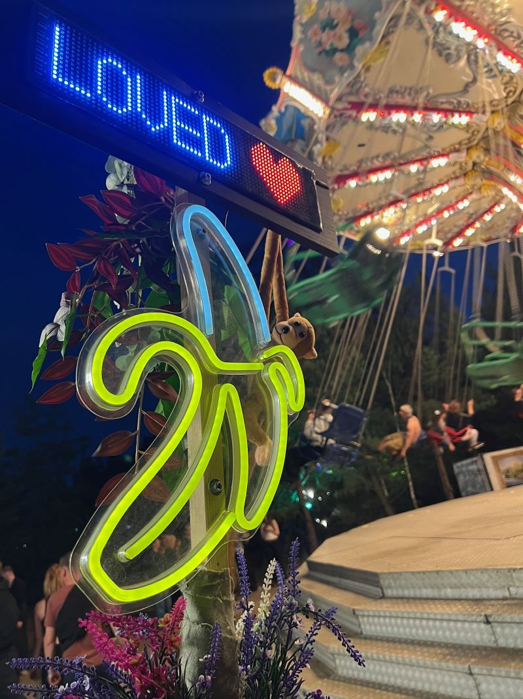

<h1 align="center">🍌 RavestickBoard</h1>

<strong>Offline-Webcontroller für die 64 × 16-Pixel-LED-Tafel CoolLEDX / CoolLED1248 mit ESP32-C3.</strong> 
Entstanden aus einer Festival-Banane und dem Wunsch, mehr aus der ursprünglichen CoolLED1248-App herauszuholen.

> **Aktueller Entwicklungskandidat: v0.8.2-dev (27.11.2026).** *Neu in 0.8.2 (nur Weboberfläche):* **Bildart „Pixelgrafik“** mit der Farbumsetzung **Mehrheitsfarbe** (Automatik bei höchstens 16 Farben, Rahmen springt auf 1:1), **Zahlenfelder** neben Helligkeit und Kontrast, **„Anker und Vorlagen“ einklappbar**, einheitliche Abstände im Schwenk-Import, **Rückfragen beim Quellwechsel**, die Korrekturen aus zwei Audits (Speichern, Eingaben, GIF-Decoder, Editor) und [Hinweise für Reviewer](docs/AUDIT_HINWEISE.md). Am Rechner geprüft, noch nicht kompiliert und nicht auf der Hardware getestet. **Davor v0.8.1:** **v0.7.2 ist auf echter Hardware getestet (26.11.2026, 28 Minuten ohne Fehler und Neustart) und die Rückfallversion.** 0.8.1 ersetzt den ersten Stand 0.8.0 (nur auf dem Rechner geprüft, noch nicht getestet) und bündelt die Beobachtungen daraus. *Neu in 0.8.1:* **Schwenk / Einzelbilder** mit **Start- und Ende-Rahmen** auf dem Quellbild (Rahmen ziehen, Größe ändern = Zoom, Anker und Vorlagen, Haken „Ohne Überlappung“ für Kachel-für-Kachel), vier Importkacheln (GIF, Schwenk / Einzelbilder, Text-Raster, Neu zeichnen), **Frame-Editor** mit großen, beschrifteten Flächen auf Laptop und iPad und einer Kompaktleiste mit „Mehr“ auf schmalen Handys im Querformat, Pfeile in der Frame-Leiste wählen das Frame (Schalter „Verschieben“ schiebt es), **Rückfrage beim Verwerfen** ungespeicherter Änderungen (Zurück-Pfeil und Menü), dazu die Korrekturen aus dem Code-Review (Auswahl am Bildrand, Speichern direkt nach einer Zeitänderung, Wiederherstellen, Bildspeicher). Die Firmware ist bis auf die Versionsnummer unverändert. Am Rechner geprüft, **noch nicht kompiliert und noch nicht auf der Hardware getestet.**

## Was ist RavestickBoard?

Das iPhone oder ein anderer Browser verbindet sich mit dem WLAN `RavestickBoard` des **ESP32-C3 Super Mini**. Das lokale Webinterface unter **http://192.168.4.1** überträgt die Darstellung per Bluetooth Low Energy an die **CoolLEDX-Tafel**. Die Tafel braucht keine modifizierte Herstellerfirmware und wiederholt einmal hochgeladene Inhalte selbstständig. Die Oberfläche läuft ohne Internet und ohne App; USB bleibt der einzige Firmware-Updateweg (**kein OTA**).

## Warum RavestickBoard?

Die Hersteller-App läuft auf einem Handy und hält die Bluetooth-Verbindung selbst. RavestickBoard verlegt das auf einen kleinen ESP32 an der Tafel und bietet dafür mehr:

- **Keine App, kein Bluetooth am Handy:** Jeder Browser im WLAN `RavestickBoard` genügt, auch der Laptop; zwei Geräte gleichzeitig. Alles läuft offline.
- **Deine Inhalte liegen im Gerät:** Bibliothek, Programme, Kurzwahlen und Animationen stehen im ESP32 und sind auf allen Geräten gleich; ein JSON-Backup sichert Bibliothek, Programme, Animationen und Kurzwahlen, ganz oder nach Auswahl.
- **Schnell bei der Veranstaltung:** acht Kurzwahl-Kacheln, Programme, die Einträge nacheinander oder als Laufband abspielen, Ambiente-Farben auf Fingertipp.
- **Mehr Gestaltung:** Farbe und Schrift **pro Zeichen**, Original-Schriften, Engschrift und Mini (ein- oder zweizeilig), **85 eigene Symbole** mit Suche, Blocktexte mit bis zu 40 Seiten.
- **Eigene Animationen:** GIF, Einzelbilder aus einem Bild oder Text-Raster importieren, zuschneiden, auf die sieben LED-Farben bringen, speichern und senden.
- **Sehen, was ankommt:** Live-Vorschau der 64 × 16-Matrix mit Datenbudget vor dem Senden.
- **Robust und nachvollziehbar:** Wächter gegen Hänger, Absturzspur, Heap-Schutz, Diagnose mit Export als Textdatei.
- **Offen:** MIT-Lizenz, Quelltext und Tests im Repository.

Die Hersteller-App bleibt daneben nutzbar, darf aber nicht gleichzeitig mit der Tafel verbunden sein.

## Funktionen auf einen Blick

Ausführlich nach Themen: **[docs/FUNKTIONEN.md](docs/FUNKTIONEN.md)**.

- **Kurzwahl:** acht Kacheln für Texte, Programme, Animationen und Ambiente.
- **Lauftext:** Schriften, Zeichen gestalten, Symbole, Vorschau, Datenbudget.
- **Blocktext:** bis zu 40 Seiten mit Ausrichtung und Anzeigedauer.
- **Animationen:** Import, Ausschnitt-Rahmen, Raster als Schnellmenü, Liste als Editor, bis zu 40 Animationen à 79 Bilder.
- **Bibliothek und Programme:** speichern, sortieren, Mehrfachauswahl am Laptop, Vorschau.
- **Tafelverwaltung:** „Meine Tafel“, Suche mit Signalstärke, fremde Tafel mit Rückweg, Vor-Scan.
- **Tafelsteuerung:** Helligkeit, Tempo, an/aus, Anzeigeverhalten; Sperre aller Geräte während einer Übertragung.
- **Diagnose:** RAM-Messung, HTTP-Spur, Absturzspur, Export als Textdatei.
- **Einstellungen:** WLAN-Passwort ändern (Zurücksetzen per BOOT-Taste), WLAN-Puffer und WPA2/WPA3, JSON-Backup mit Auswahl (Bibliothek, Programme, Animationen, Kurzwahlen).
- **Kurzbefehle:** Lauftext, Kurzwahl oder Animation ohne Browser auslösen, mit der Kurzbefehle-App/Siri am iPhone oder einer App unter Android ([docs/KURZBEFEHLE.md](docs/KURZBEFEHLE.md)).

## Aktuell: v0.8.2-dev – Pixelgrafik und Review-Korrekturen

- **Bildart und Mehrheitsfarbe:** In der Import-Maske (GIF und Schwenk) wählt **Bildart** zwischen „Foto oder Verlauf“ (Floyd-Steinberg) und **„Pixelgrafik“** (Farbumsetzung **Mehrheitsfarbe**: jedes Tafelpixel bekommt die häufigste Farbe seines Bildbereichs, scharf und ohne Rasterpunkte). Bilder mit höchstens 16 Farben werden automatisch als Pixelgrafik erkannt; der Rahmen springt auf **1:1** (64 × erkanntem Vergrößerungsfaktor Bildpixel breit, bei einem 2-fach vergrößerten Bild also 128) und lässt sich danach frei anpassen. Schwelle und Kontrast sind bei Pixelgrafik gesperrt.
- **Zahlenfelder** neben „Helligkeit der Schwelle“ und „Kontrast“; **„Anker und Vorlagen“** klappt im Schwenk auf und zu (zu beim Start); die Abstände der Maske sind vereinheitlicht.
- **Rückfragen:** Wer ein neues Bild, GIF, Raster oder „Neu zeichnen“ beginnt, während ein ungespeicherter Entwurf offen ist, wird gefragt; „Abbrechen“ erhält den Entwurf. Beim Speichern sind Quellwahl, Einstellungen und Zurück gesperrt. Von/Bis/Schritt rechnen immer mit ganzen Zahlen; unvollständige GIF-Dateien werden abgelehnt.
- **Firmware:** unverändert bis auf Versionsnummer und Kommentar-/Diagnosetexte. **Prüfung am Rechner:** alle Tests mit Endung `0802` (neu `test_browser_lifecycle_0802.py`). **Noch nicht kompiliert und nicht auf der Hardware getestet.** Für Reviews: [docs/AUDIT_HINWEISE.md](docs/AUDIT_HINWEISE.md).

## Davor: v0.8.1-dev – Schwenk mit zwei Rahmen und Frame-Editor

- **Schwenk / Einzelbilder (eine Importquelle):** Bild beliebiger Größe wählen (größer als 4096 Pixel an der längsten Kante wird verkleinert, mit Hinweis). Auf dem Bild liegen zwei Rahmen im Tafelformat 4 : 1: **Start (gelb)** und **Ende (weiß gestrichelt)**; die Frames dazwischen entstehen von selbst. Rahmen mit Finger, Stift oder Maus ziehen; an den Ecken, mit zwei Fingern oder dem Mausrad die Größe ändern. Gleich große Rahmen schwenken, unterschiedlich große **zoomen** (die Breite ändert sich gleichmäßig je Frame; angezeigt wird „Größenänderung je Frame“). Der Haken **„Größe gleich“** (Vorgabe an) koppelt beide Rahmen. Außerhalb des Bildes ist die Tafel schwarz. **Anker** (3 × 3 für Start und Ende) und **Vorlagen** (Links → Rechts, Rechts → Links, Oben → Unten, Unten → Oben, Ganzes Bild durchlaufen, Rahmen 1:1, Höhe einpassen) setzen die Rahmen mit einem Tipp. Die Zahlenfelder (Frames, Start, Ende, Versatz, Rahmenbreite, Rand) bleiben zum Feinschliff und folgen den Rahmen. Rand: „Stoppen“ oder „Umlauf (nahtlos)“; der Knopf für die nahtlose Schleife gilt nur bei gleich großen Rahmen und ist sonst mit Begründung gesperrt.
- **Ohne Überlappung (Kachel für Kachel):** Haken im Schwenk; der Versatz ist dann genau die Rahmenbreite beziehungsweise -höhe, die Frames sind ganze Kacheln, die Schnittlinien liegen auf dem Bild. Der frühere Weg „Einzelbilder aus einem Bild“ mit quadratischen Kacheln (Sprite-Sheet) ist entfernt; Einzelbilder gehen jetzt über diesen Haken.
- **Importmenü:** vier Kacheln – GIF, Schwenk / Einzelbilder, Text-Raster, Neu zeichnen (am Laptop und iPad in einer Reihe, am Handy 2 × 2).
- **Rückfrage beim Verwerfen:** Wer ein Bild, GIF oder Raster geladen oder etwas an einer Animation geändert hat und über den Zurück-Pfeil oder das Menü weggeht, ohne zu speichern, wird gefragt. „Nur senden“ zählt nicht als Speichern. Ohne Änderung keine Rückfrage.
- **Frame-Editor:** zwei Wege hinein – **Bilder bearbeiten** bei einer gespeicherten Animation (Stift in der Liste) und **Neu zeichnen** auf der Import-Seite (beginnt mit zwei leeren Bildern). Werkzeuge: Stift, Radierer, Füllen, Pipette, Auswahl (aufziehen, verschieben), Ansicht verschieben, Zoom, Rückgängig/Wiederherstellen; unter „Mehr“: Spiegeln links/rechts und oben/unten, Leeren, Zwiebelschicht (das vorige Bild blass darunter). Bildleiste mit neuem Bild (als Kopie), Löschen (mindestens zwei Bilder bleiben); die Pfeile wählen das vorige/nächste Frame (die Leiste läuft mit, auch per Wischen, Mausrad oder Klick), der Schalter **Verschieben** färbt die Pfeile gelb und schiebt dann das Frame in der Reihenfolge. Auf Laptop und iPad (ab 820 × 560 Pixeln) große, beschriftete Flächen; auf schmalem Handy im Querformat (unter 760 Pixeln Breite) eine Kompaktleiste, bei der Ansicht verschieben und Zoom unter „Mehr“ liegen. Eine Zeit gilt für die ganze Animation; ein längeres Bild entsteht durch ein kopiertes Bild.
- **Handy nur quer, überall nur bei ausreichend großem Zeichenfeld:** Der Editor braucht, dass ein Tafelpixel mindestens sechs Bildschirmpixel groß ist. Auf dem **Handy im Hochformat** (Fensterbreite unter 600 Pixeln) erscheint „Bitte das Handy ins Querformat drehen“, auf einem **zu kleinen Bildschirm** „Der Bildschirm ist zu klein zum Zeichnen“; iPad und Laptop dürfen auch hochkant arbeiten. Nur der Editor ist dann gesperrt; Importieren, Senden und alles andere bleiben benutzbar. Auf größeren Bildschirmen lässt sich weiter hineinzoomen (ein Tafelpixel bis 60 Bildschirmpixel).
- **Zoom nur im Zeichenfeld:** Zwei-Finger-Zoom, Zoom-Knöpfe und Mausrad wirken nur auf das Zeichenfeld, nie auf die ganze Seite; ein Finger oder der Stift zeichnet (Fingerberührungen werden anderthalb Sekunden nach einem Stiftkontakt ignoriert, als Schutz vor dem Handballen).
- **Nicht in 0.8.1:** Textwerkzeug (Tafelschriften und Symbole als Pixel auf ein Bild legen), Linie/Rechteck/Kreis. Beides ist in der [Roadmap](docs/ROADMAP.md) vorgemerkt.
- **Kleinpaket aus dem Test von 0.7.2:** Läuft ein Programm, steht am Tempo-Regler „fest 80“ statt der Tempozahl (die Reglerhöhe ändert sich nicht); am Laptop haben alle Ansichten dieselbe Breite (Ursache war der Scrollbalken, der die Seite je nach Länge um wenige Pixel verschob; jetzt reserviert die Seite seinen Platz); die Backup-Knöpfe behalten ihre Farbe, nur der Laufbalken bleibt.
- **Firmware:** unverändert bis auf die Versionsnummer; die Weboberfläche im Sketch wuchs gegenüber 0.7.2 von 122 auf 138 KB gepackt (Programmspeicher kompiliert: 1.616.939 Byte, 77 %). Das 40-Animationen-Limit bleibt; nach dem Hardwaretest wird mit dem Editor gemessen, ob es sich ändern lässt.
- **Prüfung am Rechner:** alle Tests dieser Version grün (Endung damals `0801`, ab 0.8.2 `0802`). 0.7.2 bleibt die getestete Rückfallversion. Kein Safari, kein echter Apple Pencil, keine Zwei-Finger-Gesten auf echter Hardware.

## Davor: v0.7.2-dev – Aufräumer aus dem Hardwaretest von 0.7.1 (getestet, stabil)

- **Anlass:** Hardwaretest von 0.7.1 am 26.11.2026 (stabil, siehe oben) und die Rückmeldungen daraus. Die Firmware ist gegenüber 0.7.1 bis auf die Versionsnummer unverändert; neu geflasht wird nur, weil die Weboberfläche im Sketch liegt.
- **Ambiente:** Die Überschrift sitzt jetzt wie bei Bibliothek, Programme und Animationen (auch am Laptop).
- **Backup:** Während Export oder Import arbeitet, färben sich die beiden Knöpfe gelb und ein Laufbalken zeigt, dass etwas passiert; bei Erfolgs- oder Fehlermeldung ist beides wieder weg.
- **Programm-Maske:** Der Hinweis „Blocktexte sind bei Tempo 60–90 kalibriert …“ entfällt, weil Programme fest mit Tempo 80 laufen; die Erläuterung zur Zeitabschätzung steht in [docs/FUNKTIONEN.md](docs/FUNKTIONEN.md).
- **Mischfarben:** [docs/farbmischung](docs/farbmischung/README.md) enthält nur noch die sieben getesteten und für gut befundenen Dateien (Orange, Rot-Orange, Limette, Himmelblau, Hellblau, Pastellrot, Pastellgrün); ab 8 ms je Bild flimmern sie leicht, bei 1 ms nicht.
- **Geprüft und unverändert gelassen:** Die Meldungen bei gesperrter Übertragung („Das Programm wird beendet …“, 409) bleiben, weil Kurzbefehle und ein zweites Gerät die Sperre der Oberfläche umgehen können.
- **Offen:** Die Schätzung der Anzeigedauer langer Blocktexte (nach der Seite 40 erscheinen noch zwei Seiten, bevor nachgeladen wird) ist noch nicht nachgemessen; der Testplan enthält dafür einen Messschritt. Nicht getestet aus 0.7.1: D5, F4, L2, L3, L5.
- **Hardwaretest am 26.11.2026:** kompiliert (Programmspeicher 1.600.665 Byte, 76 %; globale Variablen 79.488 Byte) und 28 Minuten betrieben: kein ungeplanter Neustart, 19 Aufträge ohne Fehler, 1665 Bluetooth-Schreibvorgänge ohne Fehler. Die Dauer eines 40-Seiten-Blocktexts (Tempo 80) wurde mit der Stoppuhr gemessen: 63,2 s gegen berechnete 63,6 s; die Formel bleibt.

## Davor: v0.7.1-dev – Programmtempo, ruhigere Kurzwahl, Aufräumer aus dem Test von 0.7.0 (getestet, stabil)

**Hardwaretest am 26.11.2026:** Die Version wurde kompiliert (Programmspeicher 1.600.577 Byte, 76 %; globale Variablen 79.488 Byte) und auf der Hardware getestet. Sie lief 73 Minuten ohne ungeplanten Neustart und ohne Fehler (67 Aufträge, 3031 Bluetooth-Pakete ohne Schreibfehler, Hang-Wächter nie ausgelöst; kleinster freier Heap 19.560 Byte, danach unverändert). Der bisherige Funktionsumfang arbeitet zufriedenstellend; alle Wünsche aus dem Test sind in 0.7.2 eingearbeitet.

- **Programmtempo:** Programme laufen immer mit Tempo 80 (nur dort ist die Dauer von Blocktexten an der Tafel gemessen). Der Regler springt beim Start eines Programms auf 80 und bleibt danach dort; Einzelsendungen aus Bibliothek oder Kurzwahl behalten ihr Tempo.
- **Kurzwahl:** Beim Antippen entfallen die Erfolgsmeldungen (Übertragung, Animation, Ambiente, Programm); die Pille zeigt den Ablauf. Fehlermeldungen bleiben. Die Antworten der Firmware sind unverändert, Kurzbefehle auf dem iPhone sehen dasselbe wie vorher.
- **Palettenknopf:** Bei „Mini - Zweizeilig“ haben beide Farbzeilen acht Plätze, die Farbpunkte stehen exakt untereinander.
- **Animationen:** Play ist gesperrt, solange eine Übertragung läuft; der Hinweis „Play spielt sie ab“ und die ID in Liste und Vorschau sind weg (die ID für Kurzbefehle steht unter `/api/anim/list`, siehe [docs/KURZBEFEHLE.md](docs/KURZBEFEHLE.md)); die Seitenüberschrift sitzt auf gleicher Höhe wie bei den anderen Seiten.
- **Backup:** Beim Export und Import enden die Meldungen nicht mehr auf „…“; das pulsierende Symbol gibt es nur noch bei der Übertragungs-Pille.
- **Programm-Maske:** Das untere Bedienfeld entfällt beim Bearbeiten eines Programms.
- **Kurzwahl belegen:** Escape schließt das Fenster, der Fokus kehrt zum Auslöser zurück.
- **Mischfarben:** 15 Textraster-Dateien (je zwei oder drei Vollfarben-Bilder, 1 ms); nach dem Test sind in 0.7.2 sieben davon übrig.
- **Prüfung:** alle Tests mit Endung `0701` am Rechner grün, kompiliert und auf der Hardware getestet (siehe oben). Kein Safari.

## Frühere Versionen im Überblick

Vollständige Tabelle: [VERSIONSGESCHICHTE.md](VERSIONSGESCHICHTE.md) · Einzelheiten: [CHANGELOG.md](CHANGELOG.md) · die frühere lange README: [docs/archive/README_Langfassung_v0.6.1.10.md](docs/archive/README_Langfassung_v0.6.1.10.md).

| Version | Datum | Stichworte |
|---|---|---|
| 0.7.1 | 23.11. | Programme fest mit Tempo 80, Kurzwahl ohne Erfolgsmeldung, Palette bündig, Play-Sperre, 15 Mischfarben-Dateien; Hardwaretest am 26.11.: 73 Minuten ohne Fehler und Neustart, stabil |
| 0.7.0 | 21.11. | WLAN-Puffer mit Umschalter (begrenzt/Standard), Senden während eines Programms, Design-Tokens, Backup-Export mit Auswahl, Kurzbefehle für iPhone und Android, WPA2/WPA3 wählbar, aufgeräumter Quelltext; Hardwaretest am 23.11. ohne Neustart, Puffer-Vergleich ohne messbaren Unterschied |
| 0.6.1.11 | 17.11. | Gebündelte Antworten, Seitenband nur bei Bedarf, Korrekturen aus zwei Code-Reviews, Animationen im JSON-Backup, WLAN-Passwort änderbar (BOOT-Taste), Play-Taste; Hardwaretest am 17.11. ohne Neustart, Speichereinbrüche auf die WLAN-Empfangspuffer eingegrenzt |
| 0.6.1.10 | 15.11. | Bluetooth-Unterbau NimBLE-Arduino statt Bluedroid (rund 9 KB weniger RAM beim Start, 60 KB weniger Programm); Hardwaretest am 16.11. ohne ungeplante Fehler |
| 0.6.1.9 | 14.11. | Schlanke Animationsliste mit nachgeladenen Vorschaubildern (Anlass: Wächter-Neustart in `/api/anim/list`), Raster als Schnellmenü, „auf der Tafel“ als Punkt mit Flugzeug, Texteditor sperrt bei leerem Feld, Heißluftballon/Äffchen/Schwein, WLAN-Endungen in der Diagnose; Umkehren verworfen |
| 0.6.1.8 | 14.11. | 85 eigene Symbole und neues Symbol-Menü, Symbole umfärben, Animations-Raster, Import-Seite, „auf der Tafel“, Bibliotheks-Vorschau |
| 0.6.1.7 | 12.11. | Rahmen an den echten Fensterkanten (iPhone), Hinweis nur bei Datenübertragungen, Neustart-Meldung, Backup-Signal, sparsamere Exporte |
| 0.6.1.6 | 12.11. | Antworten und Sperre während einer Übertragung, fensterhohe Seiten, 40 Blocktext-Seiten, Umlaute, neun Beispiel-Animationen |
| 0.6.1.5 | 12.11. | Heap-Schutz (503, Warteseite), Modus nach Animation, Mehrfachauswahl, Rückwärts abspielen, Seitenleiste am Laptop, WLAN `RavestickBoard` |
| 0.6.1.3 bis 0.6.1.4 | 4.11. | CRC-32 für Animationsdateien, sicheres Ersetzen, Abruf in Teilen mit Heap-Schutz, kleinste freie Animations-Nummer |
| 0.6.0.0 bis 0.6.1.2 | 3.11. | Animationen: Test mit Befehl `0x04`, Import (GIF, Einzelbilder, Text-Raster), Liste, Ausschnitt-Rahmen, „Nur senden“, Kurzwahl; 0.6.0.2 und 0.6.1.1 sind Compile-Fixes |
| 0.5.0.0 bis 0.5.0.1 | 3.11. | Tafelverwaltung: „Meine Tafel“ im ESP32, Suche, fremde Tafel, keine Adresse mehr im Code |
| 0.4.4.0 bis 0.4.6.0 | 31.10. bis 3.11. | „Zeichen gestalten“ (Farbe/Schrift pro Zeichen, auch für Blockseiten), sortierbare Programme, höchstens zwei WLAN-Geräte, Vor-Scan der Tafel |
| 0.4.3.x | 30. bis 31.10. | Stabilitätsarbeit nach Hängern: Wächter, Absturzspur, RAM-Messung; Oberfläche konsolidiert, Programme im Bibliotheksstil |
| 0.4.2.x | 28. bis 30.10. | HTTP- und RAM-Stabilisierung (gzip, ETag, kleine JSON-Stücke), Blocktext als ein Bildband, Programme, acht Kurzwahlen, Bibliothek im LittleFS |
| 0.4.0 bis 0.4.1 | 26. bis 27.10. | Neue Oberfläche (Menü über die Banane), Ambiente, Bibliothek im Flash, JSON-Backup, MIT-Lizenz |
| 0.1.0 bis 0.3.5.1 | 22. bis 25.10. | Erster Webcontroller, deutsche Oberfläche, Blockseiten, 82 Original-Glyphen, Symbole, Anzeigemodi, Diagnose |

## Installation und Datensicherheit

1. Vorab ein JSON-Backup aus der aktuell laufenden Firmware erstellen und lokal aufbewahren. Die bisherige Firmware als Rückfallversion sichern.
2. In der Arduino IDE über **Sketch → Bibliothek einbinden → Bibliotheken verwalten** die Bibliothek **NimBLE-Arduino** (h2zero, Version 2.x; Apache-2.0) installieren und die Versionsnummer notieren (neu seit 0.6.1.10). Dann `firmware/RavestickBoard_v0_8_2/RavestickBoard_v0_8_2.ino` öffnen. **Alle acht Dateien** im selben Sketch-Ordner belassen: `.ino`, `RavestickBoard_WebUI.h`, `RavestickBoard_Assets.h`, `RavestickBoard_Library.h`, `RavestickBoard_Anim.h` (neu in 0.6.1.0), `RavestickBoard_v042.h`, `RavestickBoard_Icon.h` und `RavestickBoard_Ble.h` (neu in 0.6.1.10).
3. Arduino IDE: **ESP32C3 Dev Module**, Espressif **3.3.12**, **USB CDC On Boot: Enabled**, **No OTA (2MB APP/2MB SPIFFS)**. Bestehendes Partitionsschema **nicht ändern**, **Erase All Flash deaktiviert** lassen.
4. Nach dem Flashen mit WLAN `RavestickBoard` verbinden (seit 0.6.1.5; bis 0.6.1.4 `CoolLED1248`). Das Standardpasswort steht im Sketch (`WIFI_PASSWORD`) und ist damit öffentlich; es lässt sich unter **Einstellungen → WLAN-Passwort** ändern, die BOOT-Taste (im Betrieb 5 s halten) stellt das Standardpasswort und WPA2 wieder her. Dann `http://192.168.4.1` aufrufen. Bibliothek nicht neu formatieren; das Bibliotheksformat ist unverändert. Ausnahme seit 0.6.1.6: Blocktexte werden beim nächsten Speichern mit 40 Seitenplätzen abgelegt und sind danach für 0.6.1.5 und älter nicht mehr lesbar (JSON-Backup!). Für Animationen muss das Dateisystem eingerichtet sein (wie für die Bibliothek); der Ordner `/rb-anim` wird beim Start angelegt. Falls das Homescreen-Icon nicht übernommen wird, die Verknüpfung über Safari erneut hinzufügen.
5. Nach Änderungen an `web/index.html`: `python tools/sync_web.py` erzeugt den gzip-Webheader neu.

## Dokumentation

- **Funktionen nach Themen:** [docs/FUNKTIONEN.md](docs/FUNKTIONEN.md)
- **Technik und Formate:** [docs/TECHNIK.md](docs/TECHNIK.md) · **Diagnose:** [docs/DIAGNOSE.md](docs/DIAGNOSE.md) · **Entscheidungen:** [docs/ENTSCHEIDUNGEN.md](docs/ENTSCHEIDUNGEN.md)
- **Roadmap und Themenspeicher:** [docs/ROADMAP.md](docs/ROADMAP.md), [docs/THEMENSPEICHER.md](docs/THEMENSPEICHER.md) · **Quellen und Lizenzen:** [docs/QUELLEN_UND_LIZENZEN.md](docs/QUELLEN_UND_LIZENZEN.md)
- **Hardwaretest 0.8.2:** [Testplan](docs/TESTPLAN_v0.8.2.md) (dieselben Schritte als Excel-Datei `RavestickBoard_Hardwaretest_v0.8.2.xlsx`); [Hinweise für Audits](docs/AUDIT_HINWEISE.md); Testplan 0.8.1: [archiviert](docs/archive/TESTPLAN_v0.8.1.md); Ergebnis von 0.7.2: [Testplan 0.7.2](docs/archive/TESTPLAN_v0.7.2.md); ältere Pläne in [docs/archive/](docs/archive/)
- **Kurzbefehle (iPhone, Android):** [docs/KURZBEFEHLE.md](docs/KURZBEFEHLE.md)
- **Älter:** [Bibliotheksformat](docs/archive/BIBLIOTHEK_v0.4.1.md), [letzte ausführliche Installationsanleitung](docs/archive/INSTALLATION_v0.4.2.4.1.md)

**Teststand v0.8.2 (Tests mit Endung `0802`):** wie 0.8.1; neu ist `test_browser_lifecycle_0802.py` (Mehrheitsfarbe, Faktor-Erkennung, Bildart, Zahlenfelder, Aufklapper, Rückfrage beim Quellwechsel, Timer vor dem Speichern, GIF-Decoder, Undo-Grenze, Tastatur, Freigabe); `test_build_0802.py` sucht Altlast-Kommentare und meldet SKIP ohne Baseline v0_7_2. **Teststand v0.8.1 (damals Endung `0801`):** wie 0.7.2; neu war `test_browser_editor_0801.py` (Schwenk mit zwei Rahmen: Positionen, Zoom, Anker, Vorlagen, Kachelmodus, Rahmen über dem Bildrand, Ziehen mit der Maus, Stoppen und Umlauf gegen eine unabhängige Referenz; Rückfrage beim Verwerfen; Review-Fälle T01 bis T09, T12; Editor-Leiste bei 667, 740, 844 und 932 Pixeln Breite; Editor: Zeichnen, Rückgängig, Bildleiste, Auswahl, Spiegeln, Zoom, Zwei-Finger-Geste per Chrome-Protokoll ohne Seitenzoom, Sperre bei Hochformat und kleinem Bildschirm, Bearbeiten gespeicherter Animationen; Kleinpaket mit klassischem Scrollbalken bei 1280 Pixeln). `test_build_0801.py` prüft, dass die Firmware gegenüber 0.7.2 nur in Version und Web-Header abweicht. **Teststand v0.7.2 (Tests mit Endung `0702`):** wie 0.7.1; `test_build_0702.py` prüft zusätzlich die Überschrift der Ambiente-Seite, die Arbeitsanzeige am Backup, den entfernten Kalibrierhinweis, die sieben Mischfarben-Dateien und dass die Firmware gegenüber 0.7.1 nur in Version und Web-Header abweicht; `test_browser_neu_0702.py` prüft Überschrift (Handy und Laptop) und Arbeitsanzeige im Browser. **Teststand v0.7.1 (Tests mit Endung `0701`):** wie 0.7.0, dazu Prüfungen für Programmtempo 80, Kurzwahl ohne Erfolgsmeldung, Palette, Play-Sperre und entfernte Hinweise. Die Tests von 0.7.0 und davor stehen in der Git-Geschichte; Einzelheiten: [tests/README.md](tests/README.md). **Kein Arduino-Compile, keine Hardware, kein Safari:** Das prüft erst der Hardwaretest.

## Mitmachen und Sicherheit

Siehe [CONTRIBUTING.md](CONTRIBUTING.md), [SECURITY.md](SECURITY.md), [CODE_OF_CONDUCT.md](CODE_OF_CONDUCT.md) und unsere [Issue-Vorlagen](.github/ISSUE_TEMPLATE/).

## Wie wir entwickeln

Wir entwickeln RavestickBoard gemeinsam: Wir entwerfen, programmieren, dokumentieren und testen die Software im engen Austausch. Die realen ESP32-/CoolLEDX-Hardwaretests führen wir vor Ort durch; dabei unterstützen KI-gestützte Werkzeuge wie **ChatGPT und Claude** die Konzeption, Fehlersuche, Implementierung und Dokumentation. Wir unterscheiden ausdrücklich zwischen lokal geprüftem Code und hardwarebestätigten Funktionen.

## Entwicklung, Quellen und Lizenz

RavestickBoard ist eine eigenständige C++-/HTML-/JavaScript-Implementierung. Die Referenzen für die Animationsforschung sind [schulzad/coolled-sign-controller (OpenSign)](https://github.com/schulzad/coolled-sign-controller) (Protokoll und Kodierung des Befehls `0x04`), [jean-santos/coolled1248-rs](https://github.com/jean-santos/coolled1248-rs) und [zackmcmurrin-dev/coolledux-linux-uploader](https://github.com/zackmcmurrin-dev/coolledux-linux-uploader). Ergänzend dokumentieren wir den früh untersuchten [UpDryTwist/coolledx-driver](https://github.com/UpDryTwist/coolledx-driver) und [ohtaras/led](https://github.com/ohtaras/led). Die technischen Protokollfakten wurden für unsere Firmware eigenständig umgesetzt. Ob eine Datenformatvariante des anderen Panels auf unserer eigenen CoolLEDX funktioniert, ist separat zu prüfen.

**Danksagung:** Besonderer Dank an **Adam Schulz**, [OpenSign](https://github.com/schulzad/coolled-sign-controller), für den freundlichen Austausch und die technischen Hinweise zu nativer Animation (`0x04`) und BLE-Bestätigungen. Adam hat uns per E-Mail ausdrücklich erlaubt, seine Arbeit zu nutzen, zu verändern und zu portieren, und weitere Hinweise gegeben (Datenlimit, Ablauf der Bestätigungen, Zeit je Frame). Auf diesen Erkenntnissen und dem dokumentierten Format beruht der Animationstest ab 0.6.0.0. Der Code dafür ist **eigenständig geschrieben, kein OpenSign-Code wurde übernommen**; Nutzdaten und Paketierung wurden lokal gegen OpenSigns Kodierer abgeglichen (byte-identisch). OpenSign steht inzwischen unter der MIT-Lizenz (Copyright © 2026 Adam Schulz); bei einer späteren Codeübernahme bleibt der Hinweis zu erhalten, siehe [`docs/QUELLEN_UND_LIZENZEN.md`](docs/QUELLEN_UND_LIZENZEN.md).

Ebenfalls herzlichen Dank an **h2zero** und alle Mitwirkenden von **[NimBLE-Arduino](https://github.com/h2zero/NimBLE-Arduino)**, die den schlanken Bluetooth-Stack der Apache-**[Mynewt-NimBLE](https://github.com/apache/mynewt-nimble)**-Bibliothek für Arduino nutzbar machen. Seit 0.6.1.10 steckt unsere gesamte Bluetooth-Verbindung zur Tafel darauf; sie schafft im knappen Arbeitsspeicher des ESP32-C3 den Platz, den das Projekt dringend braucht. NimBLE-Arduino steht unter der Apache-Lizenz 2.0 und wird **nicht** mit diesem Repository ausgeliefert, sondern über den Arduino-Bibliotheksverwalter installiert.

**Bausteine von anderen, die RavestickBoard nutzt:**

| Baustein | Wofür | Lizenz / Hinweis |
|---|---|---|
| [Arduino-ESP32](https://github.com/espressif/arduino-esp32) (Espressif) | Boardpaket mit WLAN, Webserver, Dateisystem und Preferences | wird in der Arduino IDE installiert, nicht mitgeliefert |
| [NimBLE-Arduino](https://github.com/h2zero/NimBLE-Arduino) (h2zero) auf Basis von [Apache Mynewt NimBLE](https://github.com/apache/mynewt-nimble) | Bluetooth Low Energy zur Tafel (seit 0.6.1.10) | Apache-2.0, nicht mitgeliefert |
| [Lucide](https://lucide.dev/) (teils von Feather abgeleitet) | Icons der Oberfläche | ISC bzw. MIT, Hinweise in [THIRD_PARTY_NOTICES.md](THIRD_PARTY_NOTICES.md) |
| [OpenSign](https://github.com/schulzad/coolled-sign-controller) (Adam Schulz) und weitere oben genannte Projekte | Protokollwissen zur CoolLEDX (Animation `0x04`, Bestätigungen) | nur als Referenz; kein Code übernommen |

**Lizenz und Drittmaterialien:** Unser selbst entwickelter RavestickBoard-Code steht unter der **[MIT-Lizenz](LICENSE)** (Copyright © 2026 du13500). Die Lizenz erlaubt ausdrücklich auch kommerzielle Nutzung, Bearbeitung und Weitergabe unter ihren Bedingungen. Das Projekt wird derzeit als privates Hobbyprojekt entwickelt; das schränkt die MIT-Rechte nicht ein. Eingebettete **Lucide-Icons** stehen unter ISC, ausgewählte von Feather abgeleitete Icons zusätzlich unter MIT. Ihre erforderlichen Copyright- und Lizenzhinweise stehen in [THIRD_PARTY_NOTICES.md](THIRD_PARTY_NOTICES.md). Fremde Originalmotive, Marken und sonstige Drittmaterialien werden durch unsere MIT-Lizenz nicht automatisch mitlizenziert.

<strong>Made for the rave, powered by a banana. 🍌</strong> Independent project, not affiliated with the CoolLED1248/CoolLEDX manufacturer.

