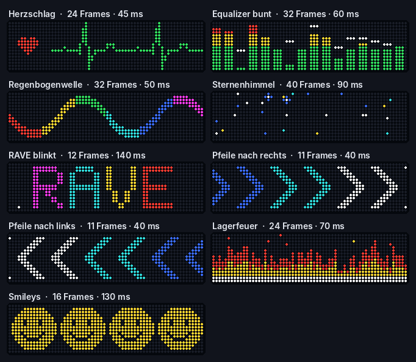

# Beispiel-Animationen

Neun fertige Animationen für die 64 × 16-Tafel, jeweils als **Text-Raster** (ein Zeichen pro LED, Bilder durch `---` getrennt). Sie entstanden als Platzhalter im Entwurf der Animations-Übersicht (12.11.2026) und sind mit `tools/beispiel_animationen.py` erzeugt.

## So kommen sie auf die Tafel

1. In der Weboberfläche **Animationen → + → Text-Raster (aus Excel) → Textdatei laden** und eine der `.txt`-Dateien wählen.
2. **Zeit je Frame** auf den Wert aus der Tabelle stellen (der Import schlägt 200 ms vor; die Zeit steckt nicht in der Datei).
3. Name prüfen (aus dem Dateinamen wird zum Beispiel „Pfeile rechts“) und **Speichern** oder **Speichern und senden**.

| Datei | Name | Frames | Zeit je Frame | Was passiert |
|---|---|---:|---:|---|
| `herzschlag.txt` | Herzschlag | 24 | 45 ms | EKG läuft nach links, beim Ausschlag pocht das Herz groß mit magenta Rand |
| `equalizer.txt` | Equalizer bunt | 32 | 60 ms | 16 Balken hüpfen grün/gelb/rot, weiße Spitzen fallen langsam nach |
| `regenbogenwelle.txt` | Regenbogenwelle | 32 | 50 ms | Welle zieht nach links, die Farben wandern doppelt so schnell mit |
| `sternenhimmel.txt` | Sternenhimmel | 40 | 90 ms | Sterne glimmen auf und verlöschen, einmal pro Runde eine Sternschnuppe |
| `rave_blinkt.txt` | RAVE blinkt | 12 | 140 ms | Buchstaben tauschen reihum die Farben, zweimal pro Runde ein weißer Blitz |
| `pfeile_rechts.txt` | Pfeile nach rechts | 11 | 40 ms | Winkel laufen nach rechts und werden heller (blau → cyan → weiß) |
| `pfeile_links.txt` | Pfeile nach links | 11 | 40 ms | Spiegelbild: Winkel laufen nach links und werden nach links heller |
| `lagerfeuer.txt` | Lagerfeuer | 24 | 70 ms | Flammen flackern, Funken steigen auf |
| `smileys.txt` | Smileys | 16 | 130 ms | Reihum zwinkert einer und streckt kurz die Zunge raus |

Alle laufen als saubere Schleife. Die Vorschau im Browser ist eine Näherung; wie flüssig die Tafel 40 ms (Pfeile) wirklich abspielt, zeigt erst der Hardwaretest.

## Selbst ändern

Die Dateien lassen sich in Excel oder einem Texteditor bearbeiten: `.` aus, `R` rot, `G` grün, `B` blau, `C` cyan, `M` magenta, `Y` gelb, `W` weiß; 64 Zeichen pro Zeile, 16 Zeilen pro Bild, höchstens 79 Bilder. Wer die Bewegungen im Code anpassen möchte: `python tools/beispiel_animationen.py assets/animationen` erzeugt alle Dateien und die Vorschau neu.

Lizenz: wie das Projekt (MIT), eigene Gestaltung.
